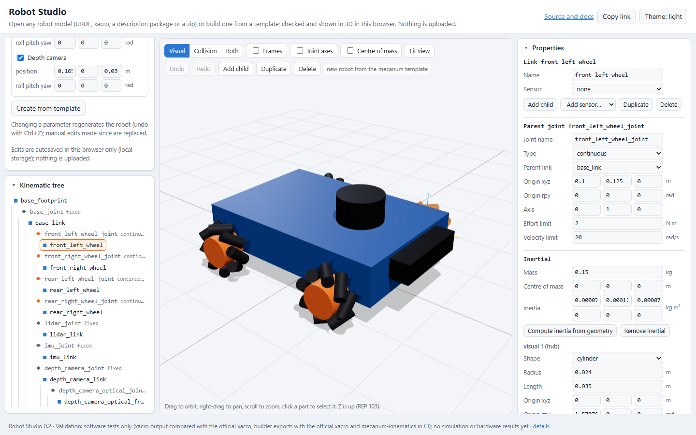
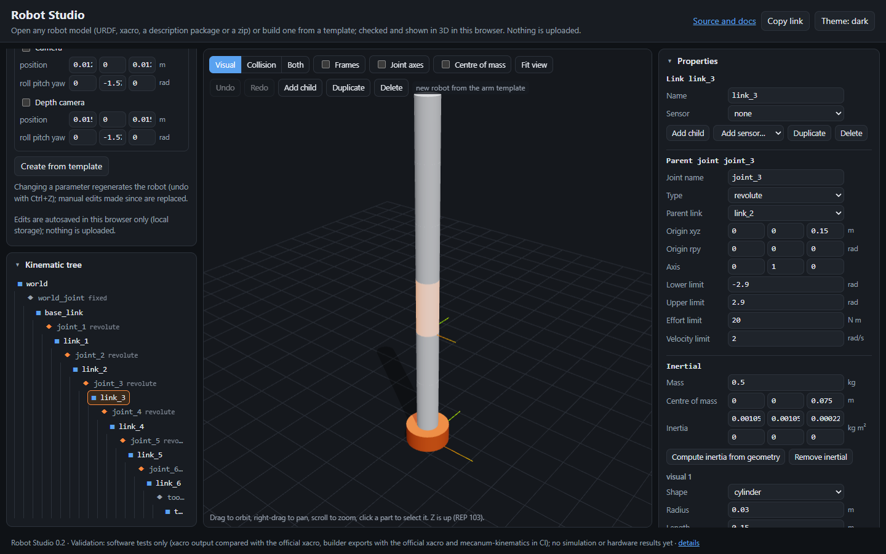
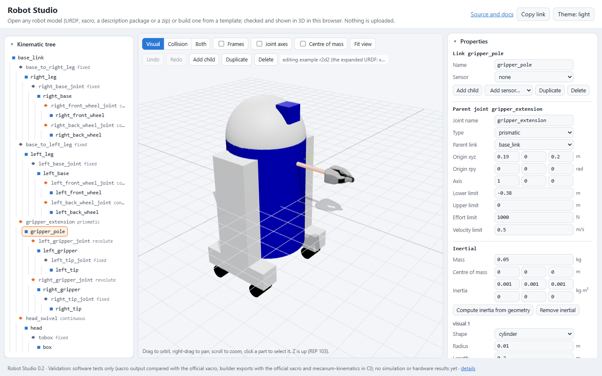
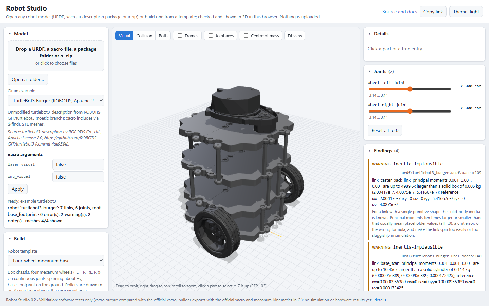
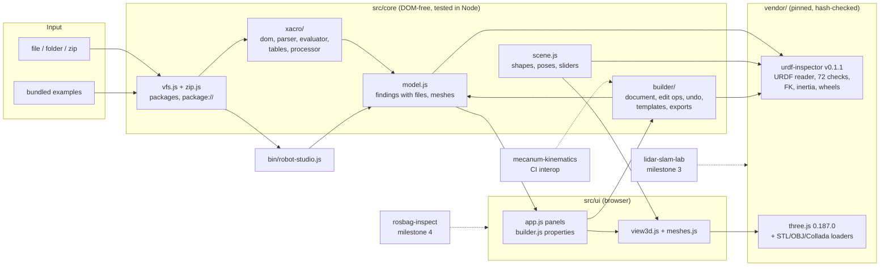

# Robot Studio

[](https://github.com/projectbin07-stack/robot-studio/actions/workflows/ci.yml)
[](LICENSE)

Open or build a robot model in the browser. Open a URDF or xacro file, a
whole ROS description package or a zip: Robot Studio expands the xacro
itself, checks the model, and shows it in 3D with its meshes and joint
sliders. Or build one: start from a mecanum, differential or arm template,
edit links and joints, and export URDF, xacro, a mecanum-kinematics config
or a ROS 2 description package. No ROS install, no upload.

**Live:** <https://projectbin07-stack.github.io/robot-studio/>

> **Validation status (v0.2.0):** software tests only. xacro output is
> compared with the official `xacro` in CI on 45 inputs (21 of 23
> successful expansions byte-identical, 2 within 1 ulp). The builder's
> exports are checked against other tools in CI: the official xacro expands
> the exported xacro to the exported URDF, mecanum-kinematics loads the
> exported TOML and agrees with Robot Studio's kinematics, and exported ROS 2
> packages build with colcon in `ros:humble-ros-base`. No simulation results
> exist yet, and nothing has been run against real robot hardware. See
> [Validation status](#validation-status).



## What it is and where it is going

Robot Studio is the flagship of this account's robotics tools: one browser
app that ties together the separate repositories instead of duplicating
them. It is built in five milestones ([ROADMAP](docs/ROADMAP.md)):

1. **Model (0.1):** open any model; xacro expansion; 3D view with
   meshes; live checks from [urdf-inspector](https://github.com/projectbin07-stack/urdf-inspector).
2. **Builder (0.2, this release):** create and edit links and joints,
   templates (mecanum, diff drive, arm) with sensor mounts, export URDF,
   xacro, a [mecanum-kinematics](https://github.com/projectbin07-stack/mecanum-kinematics)
   config and a ROS 2 package.
3. **Simulation:** drive kinematics, LiDAR (from
   [lidar-slam-lab](https://github.com/projectbin07-stack/lidar-slam-lab)),
   IMU, encoders, TF and plots, always labelled simulated.
4. **ROS 2:** a rosbridge client for a live robot view and `cmd_vel`, and
   bag replay through [rosbag-inspect](https://github.com/projectbin07-stack/rosbag-inspect).
5. **Release polish:** docs, performance budget, accessibility, upstream
   fixes.

## Builder (new in 0.2)

- **Templates:** four-wheel mecanum base, differential base with caster,
  serial arm with 1 to 50 revolute joints. Dimensions, wheel radius and
  width, wheelbase, track, masses and limits are parameters; LiDAR, IMU,
  camera and depth camera mounts are switched on and placed by you. Every
  template robot has no errors or warnings from urdf-inspector's checks.
- **Edit anything:** select a link or joint in the 3D view or the tree and
  edit it in the Properties panel (numeric fields): name (references
  follow), joint type, parent (re-parent keeps the world pose), origin,
  axis, limits, geometry, colour, mass, inertia. Add child, add sensor,
  duplicate and delete subtrees. Undo/redo with Ctrl+Z / Ctrl+Y; Delete
  removes the selected link. Checks and the 3D view update after every edit.
- **Edit an opened model:** any URDF, xacro, package folder or zip becomes
  an editable robot (its expansion; meshes still resolve).
- **Inertia from geometry** with urdf-inspector's formulas, rotated with
  the shape (so it passes the `inertia-axes` check).
- **Exports:** URDF; xacro with the template parameters as
  `xacro:property` and sensor switches as `xacro:arg`; a
  mecanum-kinematics TOML for mecanum bases; a ROS 2 description package as
  a zip (package.xml, CMakeLists.txt, urdf/, meshes/, launch file with
  robot_state_publisher, joint_state_publisher_gui and RViz).
- **Autosave** of the working robot in this browser's local storage
  (`?s=builder` restores it); never uploaded.

Details, formats and how each export is verified: [docs/builder.md](docs/builder.md).

| Arm template, dark theme                                                   | Imported R2D2 tutorial robot being edited                                         |
| -------------------------------------------------------------------------- | --------------------------------------------------------------------------------- |
|  |  |

## Viewer features (0.1)

- **xacro in the browser and the CLI**, written from the xacro docs and
  checked against the official implementation: properties (lazy, scoped,
  blocks), args, macros with defaults, `^` / `^|` inheritance and `*` / `**`
  block parameters, conditionals, includes with `$(find)`, namespaces and
  globs, `xacro:element` / `xacro:attribute` / `xacro:call`, `$(eval)`, and
  `${}` expressions evaluated by a **safe Python-subset evaluator** (no
  `eval`) with Python's int/float semantics. Errors name file:line and the
  macro and include trace. Full list and the honest unsupported list:
  [docs/xacro.md](docs/xacro.md).
- **Open anything:** drop a file, a folder or a `.zip` (built-in zip reader),
  or use the folder picker. `package://` and relative mesh paths resolve
  inside what you dropped; missing meshes show a magenta placeholder and a
  finding.
- **3D view** (three.js): STL, OBJ and COLLADA meshes with colours and
  textures, orbit/pan/zoom, shadows, grid, visual / collision / both, link
  frames, joint axes, centre of mass, click to select, Z up (REP 103).
- **Joint sliders** that respect limits (continuous joints ±π, mimic joints
  follow) and drive urdf-inspector's forward kinematics live.
- **Live checks:** urdf-inspector's 72 checks run on the expanded model;
  each finding names the file and line it came from and selects its link or
  joint. Robot Studio adds `mesh-missing` and xacro warnings.
- Kinematic tree, details panel (pose, inertia, geometry, mesh status),
  xacro argument form, download of the expanded URDF, shareable links,
  light and dark themes, phone layout.
- **Examples:** studio_mecanum (written for this project, illustrative),
  TurtleBot3 Burger (ROBOTIS, Apache-2.0), the ROS URDF tutorial robot
  (BSD-3-Clause) and ros2_control_demos RRBot (Apache-2.0), unmodified and
  attributed ([sources](tests/corpus/SOURCES.md)).
- **CLI:** `robot-studio xacro` and `robot-studio check`.

| Dark theme, R2D2 tutorial robot with COLLADA gripper meshes                           | Phone width                                               |
| ------------------------------------------------------------------------------------- | --------------------------------------------------------- |
|  |  |



## Quick start

In the browser: open the [live page](https://projectbin07-stack.github.io/robot-studio/)
and drop your description package folder (or a zip of it) onto it. The
best candidate file (`*.urdf.xacro` with a `<robot name=...>`) opens; pick
another one in "File to open".

Locally:

```bash
git clone https://github.com/projectbin07-stack/robot-studio.git
cd robot-studio
npm ci                 # dev tools only
npm run serve          # http://127.0.0.1:8000/
```

CLI (Node 22 or newer), viewer:

```console
$ node bin/robot-studio.js check examples/studio_mecanum/urdf/studio_mecanum.urdf.xacro
examples/studio_mecanum/urdf/studio_mecanum.urdf.xacro (xacro, 4 file(s))
  robot 'studio_mecanum': 11 links, 10 joints (4 continuous, 6 fixed), root base_footprint
  mass 3.054 kg, centre of mass (0.0065, 0.0000, 0.0592) m in base_footprint
  meshes: 2 of 2 found
  0 error(s), 0 warning(s), 1 note(s)

INFO  wheel-base-summary  (examples/studio_mecanum/urdf/mecanum_wheel.xacro:50)
      4 drive wheel(s) in base_link (FL=front_left_wheel_joint, FR=front_right_wheel_joint, RL=rear_left_wheel_joint, RR=rear_right_wheel_joint), radius 0.04 m, lx 0.1 m, ly 0.1225 m (export-mecanum writes a mecanum-kinematics config)
      at /robot/joint[@name='front_left_wheel_joint']

$ node bin/robot-studio.js xacro my_robot.urdf.xacro use_camera:=false -o my_robot.urdf
```

```
robot-studio xacro <in.xacro> [--arg name=value ...] [name:=value ...] [-o out.urdf]
robot-studio check <robot.urdf|robot.xacro> [--arg name=value ...] [--json] [--strict]
  --package name=dir   folder of a ROS package for $(find) and package:// (repeatable);
                       packages next to the input file's package are found automatically
Exit codes: 0 no errors (and no warnings with --strict), 1 warnings with --strict,
            2 xacro failed or the model has errors, 3 usage or file error.
```

Builder from the command line:

```console
$ node bin/robot-studio.js templates
$ node bin/robot-studio.js new mecanum --set wheel_radius=0.05 --set camera=true -o bot.urdf
$ node bin/robot-studio.js new mecanum -f toml
$ node bin/robot-studio.js new arm --set dof=6 -f xacro -o arm.urdf.xacro
$ node bin/robot-studio.js export my_robot.urdf.xacro -f package -o my_robot_description.zip
```

`new` and `export` take `--format urdf|xacro|toml|package` (package needs
`-o file.zip`). `robot-studio new mecanum -f toml` prints:

```toml
# Generated by urdf-inspector from the URDF geometry. Check every value
# against the real robot before using it for odometry.
name = "mecanum_bot"
description = "Measured from URDF 'mecanum_bot' (frame base_link)"

wheel_radius = 0.04      # m, mean of the wheel cylinders
half_length = 0.1       # m, lx: wheel centroid to wheel centre along x
half_width = 0.125        # m, ly: wheel centroid to wheel centre along y
roller_angle_deg = 45.0   # not in the URDF; 45 for ordinary mecanum wheels
# ticks_per_rev and gear_ratio are not in the URDF; add them for encoder odometry.
max_wheel_speed = 20   # rad/s, smallest wheel <limit velocity>
wheel_order = ["FL", "FR", "RL", "RR"]
...
```

`robot-studio xacro` prints the same text the official `xacro` prints (the
CI test compares the CLI's TurtleBot3 output with the official one byte for
byte), minus xacro's "autogenerated" banner.

## Architecture



Reuse is by vendoring at pinned tags: `scripts/vendor.mjs` copies the needed
files of urdf-inspector (tag `v0.1.1`) and three.js (`0.187.0`) into
`vendor/` with a SHA-256 manifest, and a CI job re-fetches both and fails on
any difference. Nothing in `vendor/` is edited; changes that Robot Studio
needs from urdf-inspector are listed in
[docs/upstream-requests.md](docs/upstream-requests.md). The reasons for this
and the other design choices (three.js, the separate XML reader for xacro,
the expression evaluator, COLLADA axes) are in
[docs/decisions.md](docs/decisions.md). For the module map and how to run
everything, see [docs/HANDOFF.md](docs/HANDOFF.md).

## Validation status

Kept as three separate tiers in every release:

| Tier               | Status in 0.2.0                                                                                                                                                                                                                                                                                                                                                                                                                                                                                                                                                                                                                                                                                                                                                                                                                                                                                                                                                                                                                                                                                                                                                                                                                                                                                                                                                                                                                                                                                                                                                                                                                                                                                                                           |
| ------------------ | ----------------------------------------------------------------------------------------------------------------------------------------------------------------------------------------------------------------------------------------------------------------------------------------------------------------------------------------------------------------------------------------------------------------------------------------------------------------------------------------------------------------------------------------------------------------------------------------------------------------------------------------------------------------------------------------------------------------------------------------------------------------------------------------------------------------------------------------------------------------------------------------------------------------------------------------------------------------------------------------------------------------------------------------------------------------------------------------------------------------------------------------------------------------------------------------------------------------------------------------------------------------------------------------------------------------------------------------------------------------------------------------------------------------------------------------------------------------------------------------------------------------------------------------------------------------------------------------------------------------------------------------------------------------------------------------------------------------------------------------- |
| **Software tests** | Yes. 126 Node tests (xacro features, expression evaluator, zip reader and writer, package resolution, vendor manifest, CLI, examples, UI state, every builder edit operation with undo/redo, rename propagation, templates, inertia, import/export round trips on the bundled examples and the golden corpus, package zip, autosave); coverage of `src/core` 99.6% lines / 96.6% branches with thresholds enforced. Golden job: the official `xacro` 2.1.1 regenerates 45 outputs in CI; Robot Studio matches 21 of the 23 successful expansions byte for byte (including the three third-party descriptions and the 7 exported builder xacro files) and the other 2 except for a 1-ulp difference in 4 numbers each, fails on all 21 inputs the official tool rejects, and rejects 1 documented construct (`lambda`). The official xacro's expansion of each exported xacro equals the exported URDF. mecanum-kinematics v0.1.0 (installed from its public tag) loads the exported TOML files; wheel radius, lx and ly match the template parameters and its IK/FK agree with Robot Studio's to about 2e-15. Exported ROS 2 packages (three templates and the studio_mecanum example with meshes) build with colcon in `ros:humble-ros-base`, pass `check_urdf` and ROS's `xacro`, their launch file parses with `ros2 launch --show-args` and robot_state_publisher accepts each URDF (RViz and joint_state_publisher_gui are not in that image and were not run). Headless Chrome job loads every example, a zip upload and a phone-width view, creates a mecanum robot from the template through the UI, edits a parameter, undoes it with Ctrl+Z, exports, reloads and checks the autosave, and edits an imported model with meshes. |
| **Simulation**     | Not applicable yet (milestone 3).                                                                                                                                                                                                                                                                                                                                                                                                                                                                                                                                                                                                                                                                                                                                                                                                                                                                                                                                                                                                                                                                                                                                                                                                                                                                                                                                                                                                                                                                                                                                                                                                                                                                                                         |
| **Hardware**       | None. Nothing in this release has been run against a real robot or a bag recorded from one. No exported package has been run on a robot.                                                                                                                                                                                                                                                                                                                                                                                                                                                                                                                                                                                                                                                                                                                                                                                                                                                                                                                                                                                                                                                                                                                                                                                                                                                                                                                                                                                                                                                                                                                                                                                                  |

## How it compares

Written from the tools' own documentation and source; details and links in
[docs/prior-art.md](docs/prior-art.md).

- **RViz2** is the reference viewer inside a ROS 2 system; it needs ROS,
  takes xacro through a launch file and gets joint sliders from
  `joint_state_publisher_gui`. Robot Studio is for when no ROS machine is at
  hand, and adds the URDF checks next to the model.
- **Foxglove** loads URDF from a URL, file (desktop), parameter or topic;
  its docs do not describe xacro expansion; it has been closed source since 2024.
- **urdf-viz** (Rust) expands xacro by calling the external `xacro`
  command, so xacro input needs ROS or the Python package.
- **Phobos** is a Blender add-on for modelling and exporting URDF/SDF, a
  different job (editing in Blender).
- **ros3djs** shows the robot from a running ROS system through rosbridge.
  **urdf-loaders** (three.js) has no xacro support; the companion
  **xacro-parser** lists `^|` defaults, `xacro:call` and include namespaces
  as not implemented, all of which Robot Studio supports and checks against
  the official tool.
- Online viewers (the urdf-loaders demo, Robot Viewer) show URDF in the
  browser; Robot Viewer lists xacro support, whose extent we did not test.

## Testing

```bash
npm run check                    # format, typecheck, all tests, coverage thresholds
node scripts/golden-report.js    # golden comparison table
python scripts/xacro_golden.py --check   # with xacro installed: goldens still match the official tool
node scripts/vendor.mjs --verify # vendored files match upstream (network)
node scripts/browser-smoke.mjs --url http://127.0.0.1:8000/ --expect-links 11 --screenshot shot.png
node scripts/browser-smoke.mjs --url http://127.0.0.1:8000/ --builder   # builder scenario
node scripts/builder-fixtures.js --check  # exported template files are current
python scripts/mecanum_interop.py        # with mecanum-kinematics installed
```

## Known limitations

- `xacro.load_yaml()` is not supported yet; Python comprehensions, `lambda`
  and f-strings in `${}` are rejected (full list in
  [docs/xacro.md](docs/xacro.md#not-supported-honest-list)).
- Meshes: STL, OBJ (no `.mtl` materials) and COLLADA only.
- Floating and planar joints have no sliders.
- A link to a model you dropped cannot reopen it (files are never put in
  URLs); links to examples restore joint positions, arguments and the
  selection.
- The checks are urdf-inspector's; a clean report is not proof that the
  model is right.
- Builder: numeric fields only (no transform gizmo); mimic and dynamics are
  not editable in the panel; a xacro file is imported as its expansion
  (macros and properties are not kept); the xacro export is parametrised
  only while the robot is exactly a template's output; mecanum-kinematics
  export only for four-wheel bases (no differential model there); template
  dimensions and masses are illustrative defaults, not a real robot's.
- Autosave lives in one browser's local storage; mesh files are not stored,
  so an imported robot shows placeholders after a reload until its files
  are opened again.

## License

MIT, see [LICENSE](LICENSE). Vendored code keeps its own licence
(`vendor/three/LICENSE`, `vendor/urdf-inspector/LICENSE`), and the
third-party example descriptions keep theirs (Apache-2.0 for TurtleBot3 and
ros2_control_demos, BSD-3-Clause for urdf_tutorial; files in
`examples/third_party/*/LICENSE`).
