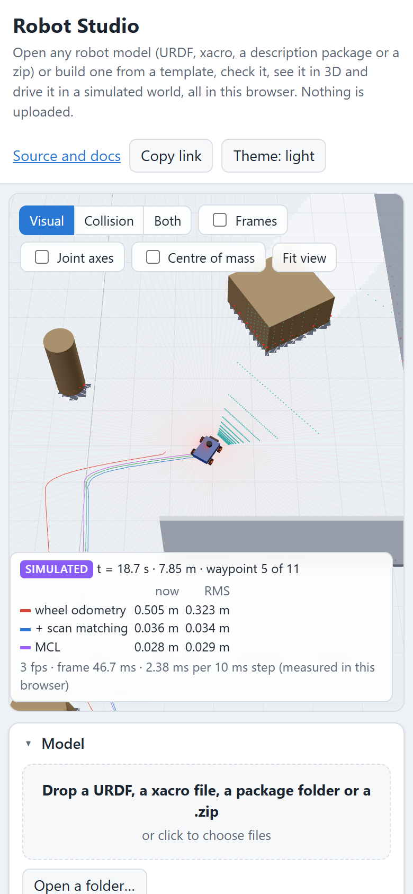
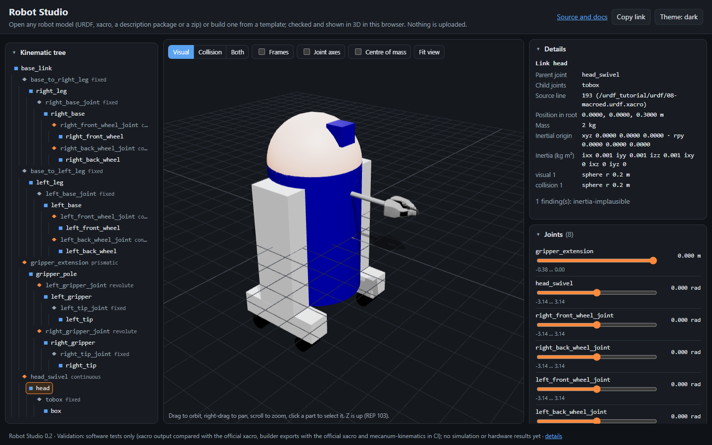
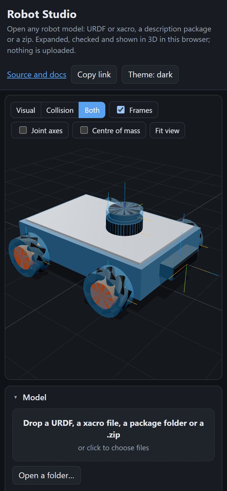
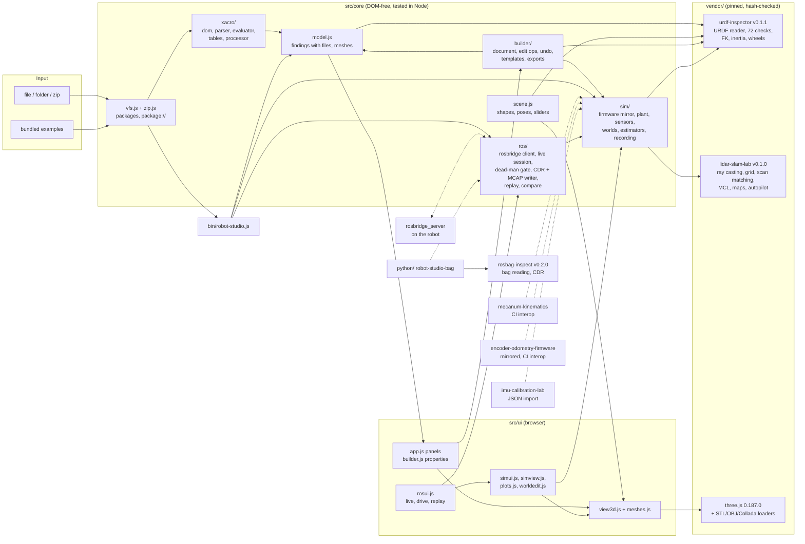

# Robot Studio

[](https://github.com/projectbin07-stack/robot-studio/actions/workflows/ci.yml)
[](LICENSE)

Open, build and simulate a robot model in the browser. Open a URDF or
xacro file, a whole ROS description package or a zip: Robot Studio expands
the xacro itself, checks the model, and shows it in 3D with its meshes and
joint sliders. Or build one: start from a mecanum, differential or arm
template, edit links and joints, and export URDF, xacro, a
mecanum-kinematics config or a ROS 2 description package. Then drive it in a
simulated world: wheels, encoders, IMU and 2D LiDAR at the robot's own URDF
frames, with wheel odometry, scan matching and MCL compared against the
simulated truth. Connect it to a ROS 2 robot over rosbridge to see the
robot's own data in the same views and drive it behind a dead-man switch;
write a simulated run as a ROS 2 bag, and replay bags through the same
estimators. No ROS install needed in the browser, no upload.

**Live:** <https://projectbin07-stack.github.io/robot-studio/>

> **Validation status (v0.4.0):** software tests: yes (Node tests on
> Ubuntu and Windows, xacro compared with the official `xacro`, builder
> exports checked with the official xacro, mecanum-kinematics and colcon;
> the rosbridge client against a fake rosbridge server; exported bags read
> by rosbag-inspect and by ROS 2 Humble's own `rosbag2_py` and `rclpy`).
> Simulation: yes, labelled as model output everywhere, including bags,
> replays and comparisons made from simulated runs. Hardware: **none**; no
> robot has been connected and no bag from a robot has been read. See
> [Validation status](#validation-status).


## What it is and where it is going

Robot Studio is the flagship of this account's robotics tools: one browser
app that ties together the separate repositories instead of duplicating
them. It is built in five milestones ([ROADMAP](docs/ROADMAP.md)):

1. **Model (0.1):** open any model; xacro expansion; 3D view with
   meshes; live checks from [urdf-inspector](https://github.com/projectbin07-stack/urdf-inspector).
2. **Builder (0.2):** create and edit links and joints,
   templates (mecanum, diff drive, arm) with sensor mounts, export URDF,
   xacro, a [mecanum-kinematics](https://github.com/projectbin07-stack/mecanum-kinematics)
   config and a ROS 2 package.
3. **Simulation (0.3):** drive the robot with
   [encoder-odometry-firmware](https://github.com/projectbin07-stack/encoder-odometry-firmware)'s
   wheel control, LiDAR, scan matching and MCL from
   [lidar-slam-lab](https://github.com/projectbin07-stack/lidar-slam-lab), an
   IMU with [imu-calibration-lab](https://github.com/projectbin07-stack/imu-calibration-lab)'s
   calibration as its error model, TF and plots, always labelled simulated.
4. **ROS 2 (0.4, this release):** a rosbridge client for a live robot
   view and `cmd_vel` behind a dead-man switch, ROS 2 bag (MCAP) export of
   simulated runs, and bag import through
   [rosbag-inspect](https://github.com/projectbin07-stack/rosbag-inspect) for
   replays and simulation-vs-robot comparisons.
5. **Release polish:** docs, performance budget, accessibility, upstream
   fixes.

## ROS 2 (new in 0.4)

Open the **ROS 2** panel. Details, the topic tables and the security notes
are in [docs/ros2.md](docs/ros2.md).


The live-view screenshot shows the fake server's simulated fixtures, not a
robot; it was taken from the live site with the browser's local-network
check turned off (see [docs/ros2.md](docs/ros2.md#live-robot-over-rosbridge)).

- **Live robot over rosbridge.** Enter the robot's rosbridge address and
  press Connect (a link can fill the address with `?ros=ws://...`, but
  nothing connects without the click). `/joint_states`, `/tf`, `/tf_static`,
  `/scan`, `/imu`, `/odom` and `robot_description` are shown with the
  simulation's 3D layers, plots and HUD under a red **LIVE: real robot**
  badge, with the LiDAR mounted where `/tf_static` puts it and the studio's
  scan matching running on the robot's odometry. A table shows each topic's
  rate, age and rejected messages. The client is written from the rosbridge
  v2 protocol and treats every message as untrusted (size limit before
  parsing, no evaluation, per-type checks).
- **Driving (`/cmd_vel`).** The same keyboard, gamepad and on-screen sticks,
  behind a dead-man switch: nothing is sent before a ticked confirmation and
  "Enable driving"; a banner says **DRIVING A REAL ROBOT**; commands go at
  10 Hz only while held and a zero Twist goes out at once on release, focus
  loss, a stalled page, hiding the page or a lost connection (the last two
  also disarm); speed is capped at 10 to 100 % of the URDF's wheel limit.
  The robot must still stop by itself when commands stop arriving.
- **Bag export.** `robot-studio sim ... --bag DIR`, `robot-studio bag
RUN_DIR -o DIR`, or "Download ROS 2 bag" in the Simulate panel: a rosbag2
  directory (MCAP + `metadata.yaml`) with `/tf_static`, `/tf`, `/odom`,
  `/scan`, `/imu`, `/joint_states`, `/cmd_vel`, `/firmware/wheel_state`,
  `/ground_truth` and a `/robot_studio/source` message saying the data is
  simulated. CI reads it with rosbag-inspect and with ROS 2 Humble's
  `ros2 bag info`, `rosbag2_py` and `rclpy`.
- **Bag import.** `robot-studio-bag` ([python/](python/README.md)) turns a
  ROS 2 bag into the recording format, reading it with rosbag-inspect
  v0.2.0 as a library: every LaserScan beam kept, inf / NaN / out-of-range
  as "no return", the LiDAR mount from `/tf_static`.
- **Replay and simulation vs robot.** `robot-studio replay DIR` or the
  panel's "Replay a recording" runs a recording through the same scan
  matching (and MCL when it has a world) with the views labelled
  **Replay**; `robot-studio compare DIR ROBOT` runs its `/cmd_vel` schedule
  on the simulator and compares the firmware's ODOMETRY and WHEEL_STATE
  fields.

```console
$ node bin/robot-studio.js sim mecanum --seconds 60 --out run --bag bag
$ robot-studio-bag bag imported
SIMULATED data (the bag says so): scan 601, imu 6000, odom 1200, joint_states 6000, cmd_vel 6000, tf 6000, tf_static 1, ground_truth 6000, wheel_state 1200, source 1
$ node bin/robot-studio.js compare imported mecanum
SIMULATION vs a SIMULATED recording (not a robot): the recording's command schedule run on the simulator
compared  1200 ODOMETRY samples over 59.95 s; 1200 WHEEL_STATE samples
field            RMS diff   max diff   final (recording / simulation)
odometry.x          0.0001     0.0001   10.9481 / 10.9482
...
```

Round trip of that 60 s run (simulation → bag → import → replay), on the
development machine: every compared value of every stream equal to the
precision of the files (108180 LiDAR beams, 13482 of them no return in
both), and identical estimator results when both are replayed.

**For the robot's owner.** No robot has been connected yet. To connect the
MentorPi (ROS 2 Humble): on the robot, `sudo apt install
ros-humble-rosbridge-suite`, start the robot as usual and run `ros2 launch
rosbridge_server rosbridge_websocket_launch.xml`. On a laptop on the same
network, run the studio locally (`git clone --branch v0.4.0 ...`, `node
scripts/serve.js`; the https live site cannot open `ws://` to another
machine) and open `http://127.0.0.1:8000/?ros=ws://<robot-ip>:9090`, then
Connect. Lift the wheels off the ground and check the robot stops by itself
before enabling driving at 10 %. Record a bag with `ros2 bag record -o
mentorpi_run /scan /odom /imu /tf /tf_static /joint_states /cmd_vel
/robot_description`, import it with `robot-studio-bag mentorpi_run
mentorpi_rec`, replay and compare it. The full checklist, including how to
record the result in this README, is in
[docs/ros2.md](docs/ros2.md#for-the-robots-owner-mentorpi).

## Simulation (new in 0.3)

Press **Simulate this robot** in the Simulate panel (or open a link with
`?sim=1`). Everything is model output and labelled "simulated".

- **The robot you opened or built**: mecanum (four wheels) or differential
  (two) detected from the URDF by urdf-inspector; the LiDAR, IMU and depth
  camera sit at the poses forward kinematics gives their links; LiDAR range,
  beams, noise and rate and IMU noise come from Gazebo `<sensor>` tags when
  the URDF has them (TurtleBot3's do).
- **Drive**: twist → inverse kinematics → saturation → per-wheel PI loop →
  motor → encoders → slip → forward kinematics → pose, mirrored from
  encoder-odometry-firmware so the simulated robot reports the firmware's
  own telemetry fields; fixed 10 ms steps, deterministic for a seed.
- **Sensors**: 2D LiDAR with lidar-slam-lab's ray caster against obstacles
  taller than its scan plane; IMU with gravity, rotation rate, noise and
  bias, taking imu-calibration-lab's JSON export as its error model; 4x
  encoders; a depth camera point cloud.
- **Estimators** from lidar-slam-lab: wheel odometry, odometry + scan
  matching with the occupancy map it builds, MCL; live and RMS errors
  against the truth.
- **Worlds with heights**: lidar-slam-lab's office, warehouse and loop, a lab
  with boxes and cylinders from 4 cm to 1.2 m, an empty room; edit walls,
  boxes, cylinders, start and route in a top-down editor; the world is kept
  in the link and in the robot document.
- **View**: the robot driving in 3D with its wheels turning, LiDAR rays and
  returns, the map, trajectories of the truth and each estimate, particles,
  the depth cloud, map/odom frames; live plots of wheel speeds, commanded and
  actual twist, IMU and errors; a HUD with errors, frame rate and the
  measured step time.
- **Drive it**: the world's demo route (autopilot), a square (strafing on a
  mecanum base), a spin, or by hand with the keyboard (W/A/S/D, Q/E strafe),
  a gamepad or on-screen sticks.
- **Record**: download the run (trajectory, LiDAR scans, IMU, the firmware's
  WHEEL_STATE and ODOMETRY telemetry, joint states, map, summary), laid out
  for a ROS 2 bag export in milestone 4.

```console
$ node bin/robot-studio.js sim mecanum --world office --route demo --seconds 60 --seed 1 --out run/
SIMULATION: model output of Robot Studio's drive, sensor and estimator models; not a measurement.
robot     mecanum_bot: mecanum, 4 wheels, r 0.040 m, lx 0.100 m, ly 0.125 m, max 20.0 rad/s
world     Office; route demo (waypoint 8 of 19); 60.0 s simulated, seed 1
sensors   LiDAR lidar_link: 180 beams, 10.0 Hz, 0.12-8.0 m (settings)
          IMU imu_link: 100 Hz, defaults (MPU-6050 datasheet typical noise density, no bias)
          encoders: 38000 counts per wheel revolution (4x), firmware control loop 100 Hz
motion    25.99 m driven, 0 blocked step(s), 0 saturated step(s)
position error   final     RMS       max
wheel odometry     1.350 m   0.746 m   1.350 m
+ scan matching    0.021 m   0.059 m   0.096 m   (100.0 % of matches accepted)
MCL (300 particles) 0.034 m   0.035 m   0.046 m
step time 1.200 ms per 10 ms step (8.3x real time; measured on this machine, not written to the files)
wrote     run/ (10 files)
```

(Step time from a GitHub Actions Ubuntu runner; the other lines are the
same on every platform CI runs on. Running the same command twice writes
byte-identical files.)

How each model works, every default and where it comes from, the recording
format with its ROS 2 topic mapping, the cross-check results and measured
performance: [docs/simulation.md](docs/simulation.md).

| Lab world with boxes and cylinders, dark theme (orange: lower than the LiDAR)                                                                                | Phone width                                                    |
| ------------------------------------------------------------------------------------------------------------------------------------------------------------ | -------------------------------------------------------------- |
|  |  |

## Builder (new in 0.2)

- **Templates:** four-wheel mecanum base, differential base with caster,
  serial arm with 1 to 50 revolute joints. Dimensions, wheel radius and
  width, wheelbase, track, masses and limits are parameters; LiDAR, IMU,
  camera and depth camera mounts are switched on and placed by you. Every
  template robot has no errors or warnings from urdf-inspector's checks.
- **Edit anything:** select a link or joint in the 3D view or the tree and
  edit it in the Properties panel (numeric fields): name (references
  follow), joint type, parent (re-parent keeps the world pose), origin,
  axis, limits, geometry, colour, mass, inertia. Add child, add sensor,
  duplicate and delete subtrees. Undo/redo with Ctrl+Z / Ctrl+Y; Delete
  removes the selected link. Checks and the 3D view update after every edit.
- **Edit an opened model:** any URDF, xacro, package folder or zip becomes
  an editable robot (its expansion; meshes still resolve).
- **Inertia from geometry** with urdf-inspector's formulas, rotated with
  the shape (so it passes the `inertia-axes` check).
- **Exports:** URDF; xacro with the template parameters as
  `xacro:property` and sensor switches as `xacro:arg`; a
  mecanum-kinematics TOML for mecanum bases; a ROS 2 description package as
  a zip (package.xml, CMakeLists.txt, urdf/, meshes/, launch file with
  robot_state_publisher, joint_state_publisher_gui and RViz).
- **Autosave** of the working robot in this browser's local storage
  (`?s=builder` restores it); never uploaded.

Details, formats and how each export is verified: [docs/builder.md](docs/builder.md).

| Arm template, dark theme                                                   | Imported R2D2 tutorial robot being edited                                         |
| -------------------------------------------------------------------------- | --------------------------------------------------------------------------------- |
|  |  |

## Viewer features (0.1)

- **xacro in the browser and the CLI**, written from the xacro docs and
  checked against the official implementation: properties (lazy, scoped,
  blocks), args, macros with defaults, `^` / `^|` inheritance and `*` / `**`
  block parameters, conditionals, includes with `$(find)`, namespaces and
  globs, `xacro:element` / `xacro:attribute` / `xacro:call`, `$(eval)`, and
  `${}` expressions evaluated by a **safe Python-subset evaluator** (no
  `eval`) with Python's int/float semantics. Errors name file:line and the
  macro and include trace. Full list and the honest unsupported list:
  [docs/xacro.md](docs/xacro.md).
- **Open anything:** drop a file, a folder or a `.zip` (built-in zip reader),
  or use the folder picker. `package://` and relative mesh paths resolve
  inside what you dropped; missing meshes show a magenta placeholder and a
  finding.
- **3D view** (three.js): STL, OBJ and COLLADA meshes with colours and
  textures, orbit/pan/zoom, shadows, grid, visual / collision / both, link
  frames, joint axes, centre of mass, click to select, Z up (REP 103).
- **Joint sliders** that respect limits (continuous joints ±π, mimic joints
  follow) and drive urdf-inspector's forward kinematics live.
- **Live checks:** urdf-inspector's 72 checks run on the expanded model;
  each finding names the file and line it came from and selects its link or
  joint. Robot Studio adds `mesh-missing` and xacro warnings.
- Kinematic tree, details panel (pose, inertia, geometry, mesh status),
  xacro argument form, download of the expanded URDF, shareable links,
  light and dark themes, phone layout.
- **Examples:** studio_mecanum (written for this project, illustrative),
  TurtleBot3 Burger (ROBOTIS, Apache-2.0), the ROS URDF tutorial robot
  (BSD-3-Clause) and ros2_control_demos RRBot (Apache-2.0), unmodified and
  attributed ([sources](tests/corpus/SOURCES.md)).
- **CLI:** `robot-studio xacro` and `robot-studio check`.

| Dark theme, R2D2 tutorial robot with COLLADA gripper meshes                           | Phone width                                               |
| ------------------------------------------------------------------------------------- | --------------------------------------------------------- |
|  |  |


## Quick start

In the browser: open the [live page](https://projectbin07-stack.github.io/robot-studio/)
and drop your description package folder (or a zip of it) onto it. The
best candidate file (`*.urdf.xacro` with a `<robot name=...>`) opens; pick
another one in "File to open".

Locally:

```bash
git clone https://github.com/projectbin07-stack/robot-studio.git
cd robot-studio
npm ci                 # dev tools only
npm run serve          # http://127.0.0.1:8000/
```

CLI (Node 22 or newer; `sim` is shown [above](#simulation-new-in-03)), viewer:

```console
$ node bin/robot-studio.js check examples/studio_mecanum/urdf/studio_mecanum.urdf.xacro
examples/studio_mecanum/urdf/studio_mecanum.urdf.xacro (xacro, 4 file(s))
  robot 'studio_mecanum': 11 links, 10 joints (4 continuous, 6 fixed), root base_footprint
  mass 3.054 kg, centre of mass (0.0065, 0.0000, 0.0592) m in base_footprint
  meshes: 2 of 2 found
  0 error(s), 0 warning(s), 1 note(s)

INFO  wheel-base-summary  (examples/studio_mecanum/urdf/mecanum_wheel.xacro:50)
      4 drive wheel(s) in base_link (FL=front_left_wheel_joint, FR=front_right_wheel_joint, RL=rear_left_wheel_joint, RR=rear_right_wheel_joint), radius 0.04 m, lx 0.1 m, ly 0.1225 m (export-mecanum writes a mecanum-kinematics config)
      at /robot/joint[@name='front_left_wheel_joint']

$ node bin/robot-studio.js xacro my_robot.urdf.xacro use_camera:=false -o my_robot.urdf
```

```
robot-studio xacro <in.xacro> [--arg name=value ...] [name:=value ...] [-o out.urdf]
robot-studio check <robot.urdf|robot.xacro> [--arg name=value ...] [--json] [--strict]
robot-studio sim <robot.urdf|robot.xacro|template> [--world W] [--route R] [--seconds S]
                 [--seed N] [--out DIR] [--imu-cal FILE] [--set key=value] [--ideal] [--json]
  --package name=dir   folder of a ROS package for $(find) and package:// (repeatable);
                       packages next to the input file's package are found automatically
Exit codes: 0 no errors (and no warnings with --strict), 1 warnings with --strict,
            2 xacro failed or the model has errors, 3 usage or file error.
```

Builder from the command line:

```console
$ node bin/robot-studio.js templates
$ node bin/robot-studio.js new mecanum --set wheel_radius=0.05 --set camera=true -o bot.urdf
$ node bin/robot-studio.js new mecanum -f toml
$ node bin/robot-studio.js new arm --set dof=6 -f xacro -o arm.urdf.xacro
$ node bin/robot-studio.js export my_robot.urdf.xacro -f package -o my_robot_description.zip
```

`new` and `export` take `--format urdf|xacro|toml|package` (package needs
`-o file.zip`). `robot-studio new mecanum -f toml` prints:

```toml
# Generated by urdf-inspector from the URDF geometry. Check every value
# against the real robot before using it for odometry.
name = "mecanum_bot"
description = "Measured from URDF 'mecanum_bot' (frame base_link)"

wheel_radius = 0.04      # m, mean of the wheel cylinders
half_length = 0.1       # m, lx: wheel centroid to wheel centre along x
half_width = 0.125        # m, ly: wheel centroid to wheel centre along y
roller_angle_deg = 45.0   # not in the URDF; 45 for ordinary mecanum wheels
# ticks_per_rev and gear_ratio are not in the URDF; add them for encoder odometry.
max_wheel_speed = 20   # rad/s, smallest wheel <limit velocity>
wheel_order = ["FL", "FR", "RL", "RR"]
...
```

`robot-studio xacro` prints the same text the official `xacro` prints (the
CI test compares the CLI's TurtleBot3 output with the official one byte for
byte), minus xacro's "autogenerated" banner.

## Architecture



Reuse is by vendoring at pinned tags: `scripts/vendor.mjs` copies the needed
files of urdf-inspector (tag `v0.1.1`), lidar-slam-lab (tag `v0.1.0`) and
three.js (`0.187.0`) into `vendor/` with a SHA-256 manifest, and a CI job
re-fetches all three and fails on any difference. Nothing in `vendor/` is
edited; changes that Robot Studio needs from them are listed in
[docs/upstream-requests.md](docs/upstream-requests.md). The Python projects
(mecanum-kinematics, encoder-odometry-firmware's host model) cannot run in
the page, so their conventions are mirrored in JavaScript and CI installs
them from their public tags and compares the numbers. The reasons for this
and the other design choices (three.js, the separate XML reader for xacro,
the expression evaluator, COLLADA axes) are in
[docs/decisions.md](docs/decisions.md). For the module map and how to run
everything, see [docs/HANDOFF.md](docs/HANDOFF.md).

## Validation status

Kept as three separate tiers in every release:

| Tier               | Status in 0.4.0                                                                                                                                                                                                                                                                                                                                                                                                                                                                                                                                                                                                                                                                                                                                                                                                                                                                                                                                                                                                                                                                                                                                                                                                                                                                                                                       |
| ------------------ | ------------------------------------------------------------------------------------------------------------------------------------------------------------------------------------------------------------------------------------------------------------------------------------------------------------------------------------------------------------------------------------------------------------------------------------------------------------------------------------------------------------------------------------------------------------------------------------------------------------------------------------------------------------------------------------------------------------------------------------------------------------------------------------------------------------------------------------------------------------------------------------------------------------------------------------------------------------------------------------------------------------------------------------------------------------------------------------------------------------------------------------------------------------------------------------------------------------------------------------------------------------------------------------------------------------------------------------- |
| **Software tests** | Yes. 181 Node tests and 10 Python tests. Viewer, xacro, builder and simulation as in 0.3 (xacro goldens from the official `xacro` 2.1.1, builder exports checked with the official xacro, mecanum-kinematics v0.1.0 and colcon in `ros:humble-ros-base`; the simulator cross-checked with mecanum-kinematics, encoder-odometry-firmware's firmware model and lidar-slam-lab's benchmark). New in 0.4: the rosbridge client, live session and dead-man switch against an in-repo fake rosbridge server (subscriptions, reconnects, malformed, oversized, binary and unknown messages, fragments, dead-man timing on a fake clock and over a real connection); CDR bytes, the MCAP writer and the bag topic mapping; replay and comparison; the Python companion (ruff, mypy strict, pytest, Ubuntu and Windows, Python 3.10 and 3.13). Exported bags are read back in CI by rosbag-inspect v0.2.0 and by ROS 2 Humble (`ros2 bag info`, every message deserialized by `rosbag2_py` + `rclpy` and compared). Coverage of `src/core` 99.5 % lines / 94.6 % branches with thresholds enforced. Headless Chrome job: every example, builder, simulation, and the live view against the fake server (connect by click, opt-in, drive, release, blur; the server's log is checked) and a replay with the comparison, with no console errors. |
| **Simulation**     | Yes, labelled as model output in every panel, plot, export and CLI report, and now in bags (`/robot_studio/source`, MCAP metadata), imported recordings and replays ("Replay: SIMULATED data") and the comparison ("vs a SIMULATED recording (not a robot)"). The round trip simulation → bag → import → replay keeps every value (details in [docs/ros2.md](docs/ros2.md#how-it-is-checked)). Simulation results and cross-checks as in [docs/simulation.md](docs/simulation.md); comparisons between models, not validation.                                                                                                                                                                                                                                                                                                                                                                                                                                                                                                                                                                                                                                                                                                                                                                                                        |
| **Hardware**       | None. No robot has been connected over rosbridge, nothing has been driven, no bag recorded from a robot has been read, and no exported package or simulated parameter has been checked on a robot. The steps for the owner's MentorPi are in [docs/ros2.md](docs/ros2.md#for-the-robots-owner-mentorpi); this row stays empty until they are done and recorded here with the date, commit and what was observed.                                                                                                                                                                                                                                                                                                                                                                                                                                                                                                                                                                                                                                                                                                                                                                                                                                                                                                                      |

## How it compares

Written from the tools' own documentation and source; details and links in
[docs/prior-art.md](docs/prior-art.md).

- **RViz2** is the reference viewer inside a ROS 2 system; it needs ROS,
  takes xacro through a launch file and gets joint sliders from
  `joint_state_publisher_gui`. Robot Studio is for when no ROS machine is at
  hand, and adds the URDF checks next to the model.
- **Foxglove** loads URDF from a URL, file (desktop), parameter or topic;
  its docs do not describe xacro expansion; it has been closed source since 2024.
- **urdf-viz** (Rust) expands xacro by calling the external `xacro`
  command, so xacro input needs ROS or the Python package.
- **Phobos** is a Blender add-on for modelling and exporting URDF/SDF, a
  different job (editing in Blender).
- **ros3djs** shows the robot from a running ROS system through rosbridge.
  **urdf-loaders** (three.js) has no xacro support; the companion
  **xacro-parser** lists `^|` defaults, `xacro:call` and include namespaces
  as not implemented, all of which Robot Studio supports and checks against
  the official tool.
- Online viewers (the urdf-loaders demo, Robot Viewer) show URDF in the
  browser; Robot Viewer lists xacro support, whose extent we did not test.

## Testing

```bash
npm run check                    # format, typecheck, all tests, coverage thresholds
node scripts/golden-report.js    # golden comparison table
python scripts/xacro_golden.py --check   # with xacro installed: goldens still match the official tool
node scripts/vendor.mjs --verify # vendored files match upstream (network)
node scripts/browser-smoke.mjs --url http://127.0.0.1:8000/ --expect-links 11 --screenshot shot.png
node scripts/browser-smoke.mjs --url http://127.0.0.1:8000/ --builder   # builder scenario
node scripts/builder-fixtures.js --check  # exported template files are current
python scripts/mecanum_interop.py        # with mecanum-kinematics installed (also checks the simulator)
node scripts/sim-fixtures.js --check      # simulator fixtures and the golden digest are current
python scripts/firmware_interop.py       # with odobridge (encoder-odometry-firmware host) installed
node scripts/lsl-crosscheck.mjs --lsl ../lidar-slam-lab   # estimators vs lidar-slam-lab's benchmark
node scripts/browser-smoke.mjs --url http://127.0.0.1:8000/ --template mecanum --sim --sim-interact
# ROS 2
node scripts/bag-fixtures.js --check && node scripts/rosbridge-fixtures.js --check
node scripts/fake-rosbridge.mjs --port 9090 --fixture tests/fixtures/rosbridge/sim_mecanum.jsonl \
  --description tests/fixtures/rosbridge/robot_description.urdf --log rb.jsonl &
node scripts/browser-smoke.mjs --url http://127.0.0.1:8000/ --template mecanum --ros ws://127.0.0.1:9090 --ros-log rb.jsonl
(cd python && pip install -e ".[dev]" && ruff check . && mypy && pytest)   # companion, pulls rosbag-inspect v0.2.0
node bin/robot-studio.js sim mecanum --out run --bag bag && robot-studio-bag bag imported
node scripts/bag-roundtrip.mjs --original run --imported imported
```

## Known limitations

- `xacro.load_yaml()` is not supported yet; Python comprehensions, `lambda`
  and f-strings in `${}` are rejected (full list in
  [docs/xacro.md](docs/xacro.md#not-supported-honest-list)).
- Meshes: STL, OBJ (no `.mtl` materials) and COLLADA only.
- Floating and planar joints have no sliders.
- A link to a model you dropped cannot reopen it (files are never put in
  URLs); links to examples restore joint positions, arguments and the
  selection.
- The checks are urdf-inspector's; a clean report is not proof that the
  model is right.
- Builder: numeric fields only (no transform gizmo); mimic and dynamics are
  not editable in the panel; a xacro file is imported as its expansion
  (macros and properties are not kept); the xacro export is parametrised
  only while the robot is exactly a template's output; mecanum-kinematics
  export only for four-wheel bases (no differential model there); template
  dimensions and masses are illustrative defaults, not a real robot's.
- Autosave lives in one browser's local storage; mesh files are not stored,
  so an imported robot shows placeholders after a reload until its files
  are opened again.
- Simulation: simulation only (the hardware tier is empty); 2D motion on a
  flat floor without dynamics; slip is a random process, not friction;
  mecanum rollers are not modelled one by one; one LiDAR, no motion
  distortion; the depth camera is geometry only and not recorded;
  lidar-slam-lab's MCL has no heading-bias term and reads a strafe as two
  rotations (with TurtleBot3's short-range LiDAR it lost track in the corridor
  loop in one documented run); scan matching has no loop closure. Headless
  browsers render on the CPU (10 to 14 fps), so the CI browser job checks
  results, not frame rate. Full list in [docs/simulation.md](docs/simulation.md#limitations).

- ROS 2: no hardware validation (see above). Topic names are fixed (relay
  others on the robot); `/cmd_vel` is a `Twist`; one LiDAR; the live view
  does not run MCL or draw the robot's own `map` frame; a browser cannot
  stop a robot over a lost connection, so the robot needs its own cmd_vel
  timeout; the https live site cannot reach `ws://` on another machine (run
  the studio locally). Full list in [docs/ros2.md](docs/ros2.md#limitations).

## License

MIT, see [LICENSE](LICENSE). Vendored code keeps its own licence
(`vendor/three/LICENSE`, `vendor/urdf-inspector/LICENSE`,
`vendor/lidar-slam-lab/LICENSE`), and the
third-party example descriptions keep theirs (Apache-2.0 for TurtleBot3 and
ros2_control_demos, BSD-3-Clause for urdf_tutorial; files in
`examples/third_party/*/LICENSE`).
