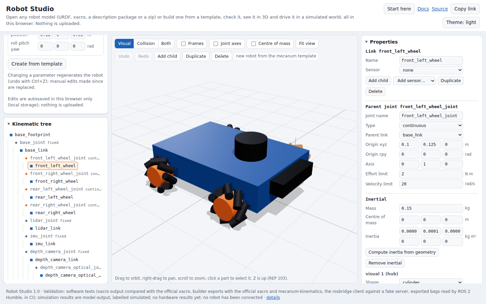

# The builder

Robot Studio 0.2 can create and edit robots, not only open them. This page
describes what the builder does, the formats it writes and how each export
is checked. Validation tiers as everywhere in this project: everything here
is **software-tested**; nothing has been run on a robot.



_Screenshot from the live site (Pages workflow, `screenshots` job)._

## Starting a robot

- **From a template** (Build panel): pick a template, set its parameters,
  _Create from template_. While the robot is unchanged since it was
  generated, editing a parameter regenerates it (one undo step).
- **From an opened model**: open any URDF, xacro file, package folder or zip
  (or an example) and click _Edit the open model_. The expanded URDF is
  imported; xacro macros and properties are not kept (the import is of the
  expansion). Mesh files keep resolving from the opened files.
- **Restore**: the working robot is saved in this browser's local storage
  after every edit. `?s=builder` (or _Restore autosaved robot_) brings it
  back after a reload. It is never uploaded; if storage is blocked or full
  the builder works without it. Mesh files are not stored, so an imported
  model shows placeholders after a reload until its package is opened again.

## Templates

| Template  | Structure                                                                                                                                                                                                                                                       | Parameters                                                                                                                                |
| --------- | --------------------------------------------------------------------------------------------------------------------------------------------------------------------------------------------------------------------------------------------------------------- | ----------------------------------------------------------------------------------------------------------------------------------------- |
| `mecanum` | `base_footprint` on the ground, `base_link` box at wheel-axle height, four wheels `front_left`, `front_right`, `rear_left`, `rear_right` on continuous joints about +y (a positive speed drives forward), rollers drawn in an "X" seen from above (visual only) | chassis size, mass and height, wheel radius, width and mass, wheelbase (2 lx), track (2 ly), wheel speed and torque limits, rollers drawn |
| `diff`    | as above with `left_wheel`, `right_wheel` and a spherical `caster_link` that touches the ground                                                                                                                                                                 | as above plus axle position, caster radius, position and mass                                                                             |
| `arm`     | massless `world` root, cylinder `base_link`, N cylinder segments on revolute joints with axes z, y, y, z, y, z (repeating), `tool0` flange                                                                                                                      | number of joints (1 to 50), base and segment size and mass, joint limit, torque and speed limits                                          |

Every template has optional sensor mounts placed by the user (position and
roll/pitch/yaw): 2D LiDAR (`lidar_link`), IMU (`imu_link`), camera
(`camera_link` + `camera_optical_frame`) and depth camera
(`depth_camera_link` + `depth_camera_optical_frame`). On the arm, cameras
mount on `tool0`, LiDAR and IMU on `base_link`. Sensors are links tagged
with a sensor kind; URDF has no sensor element, so the tag is Robot Studio
metadata (guessed from link names on import). Default dimensions and masses
are illustrative, not those of any real robot.

All template robots, with every combination tested
(`tests/builder-templates.test.js`), have **no errors and no warnings** from
urdf-inspector's checks, including `inertia-axes`.

## Editing

Select a link or joint in the 3D view or the tree; the Properties panel
edits it with numeric fields (no transform gizmo yet):

- link: rename (every reference follows: joints, mimics, `<gazebo
reference>`, `<transmission>`/`<ros2_control>` joint names, frame names in
  plugin text), sensor tag, add child, add sensor, duplicate (with its
  subtree), delete (with its subtree);
- its parent joint or a selected joint: name, type, parent link (re-parent;
  the link keeps its place in the world), origin xyz/rpy, axis, limits;
- inertial: mass (scales the tensor), centre of mass, the six tensor terms,
  _Compute inertia from geometry_;
- each visual and collision: shape (box, cylinder, sphere, mesh), size,
  origin, colour.

Every edit is one typed operation (`src/core/builder/ops.js`) applied to a
copy of the document; invalid edits are refused with a reason and change
nothing. Undo/redo: toolbar or Ctrl+Z / Ctrl+Y (Ctrl+Shift+Z); Delete
removes the selected link. After every edit, undo and redo the document's
URDF goes through the same `loadModel()` as an opened file, so the findings
are exactly urdf-inspector's. On a 51-link arm an edit plus all checks takes
a median of 10 ms on the development machine and 16 to 19 ms on the CI runners (20 edits, Node; the test prints it).

## Inertia from geometry

_Compute inertia_ uses urdf-inspector's `primitiveInertia` (solid box,
cylinder, sphere; a mesh counts as a solid box filling its bounding box,
measured by the 3D view once the mesh is drawn) for the first collision
shape, else the first visual. The centre of mass is put at the shape's
centre, the `<inertial>` frame is not rotated, and the tensor is rotated
from the shape frame with urdf-inspector's `rotateTensor`, so a wheel whose
cylinder is rolled by pi/2 gets `iyy = m r^2 / 2`. The tests check that the
un-rotated tensor is flagged by `inertia-axes` and the computed one is not.

## Exports

| Export                  | What it is                                                                                                                                                                                                                                                                                                                                                                                            | How it is checked                                                                                                                                                                                                                                                                                                                                                                                                                                                                                                            |
| ----------------------- | ----------------------------------------------------------------------------------------------------------------------------------------------------------------------------------------------------------------------------------------------------------------------------------------------------------------------------------------------------------------------------------------------------- | ---------------------------------------------------------------------------------------------------------------------------------------------------------------------------------------------------------------------------------------------------------------------------------------------------------------------------------------------------------------------------------------------------------------------------------------------------------------------------------------------------------------------------- |
| URDF                    | links, joints, materials and the carried-through elements (`<gazebo>`, `<transmission>`, `<ros2_control>`, ...), each link followed by its parent joint, origins always written                                                                                                                                                                                                                       | round trip on every bundled example and every URDF of the golden corpus: open, import, export, open again gives the same model (urdf-inspector's reading of it) and the same findings; a second export is byte-identical                                                                                                                                                                                                                                                                                                     |
| xacro                   | for an unchanged template robot: every dimension, mass and pose is a `xacro:property`, each sensor a `xacro:arg` (`use_lidar`, `use_imu`, `use_camera`, `use_depth_camera`), wheels, rollers and arm segments are macros, inertias are written as formulas. After manual edits: the URDF in a xacro file, marked as not parametrised                                                                  | expanded by Robot Studio's xacro in the tests and by the official `xacro` 2.1.1 in the CI golden job (7 cases, including sensor arguments); both equal the exported URDF                                                                                                                                                                                                                                                                                                                                                     |
| mecanum-kinematics TOML | urdf-inspector's `mecanumToml` on the wheels it measures: `wheel_radius`, `half_length` (lx), `half_width` (ly), `max_wheel_speed`, `wheel_order`; roller angle 45 deg assumed                                                                                                                                                                                                                        | CI installs mecanum-kinematics from its public tag `v0.1.0`, loads each exported TOML with `RobotConfig.from_toml`, compares r, lx, ly with the template parameters, and compares its inverse kinematics for 5 twists with Robot Studio's (computed from the wheel positions measured in the URDF) and its forward kinematics with the original twists: agreement to 2e-15 (`scripts/mecanum_interop.py`)                                                                                                                    |
| ROS 2 package (.zip)    | `package.xml` (format 3), `CMakeLists.txt` (ament_cmake), `urdf/` (URDF, plus the xacro for template robots), `meshes/` (mesh files copied from the opened files, URIs rewritten to `package://<pkg>/meshes/`), `config/mecanum_kinematics.toml` for mecanum bases, `launch/display.launch.py` (robot_state_publisher, joint_state_publisher_gui or joint_state_publisher, RViz), `rviz/display.rviz` | CI exports the three templates and the studio_mecanum example (with meshes) and, in the official `ros:humble-ros-base` image, builds them with `colcon`, runs `check_urdf` on every URDF, expands every xacro with ROS's `xacro` and checks it, parses the launch file with `ros2 launch --show-args` and starts `robot_state_publisher` on each URDF. RViz and joint_state_publisher_gui are not in that image, so the launch file is not run to the end. Set the maintainer and licence in `package.xml` before publishing |

The differential template has no TOML export: mecanum-kinematics models
four-wheel mecanum bases only, and a differential base is not one.

## From the command line

```console
$ node bin/robot-studio.js templates                     # templates and parameters with defaults
$ node bin/robot-studio.js new mecanum --set wheel_radius=0.05 --set lidar_xyz=0.1,0,0.08 -o bot.urdf
$ node bin/robot-studio.js new mecanum -f xacro -o bot.urdf.xacro
$ node bin/robot-studio.js new mecanum -f toml
$ node bin/robot-studio.js new arm --set dof=6 --set camera=true -f package -o arm.zip
$ node bin/robot-studio.js export my_robot.urdf.xacro use_camera:=false -f package -o my_robot.zip
```

## Code

```
src/core/builder/document.js   RobotDoc (plain JSON), names, tree helpers, sensor guess
src/core/builder/ops.js        typed edit operations, validation, rename propagation
src/core/builder/editor.js     history (undo/redo, 200 steps) and checks via loadModel()
src/core/builder/inertia.js    inertial from a shape (urdf-inspector's formulas)
src/core/builder/urdf.js       RobotDoc <-> URDF
src/core/builder/templates.js  templates: document generator and xacro writer
src/core/builder/actions.js    multi-step actions (add child, add sensor) as one undo step
src/core/builder/drive.js      mecanum TOML (urdf-inspector) and IK/FK from measured wheels
src/core/builder/export.js     xacro export, ROS 2 package
src/core/builder/storage.js    autosave format
src/core/zipwrite.js           stored zip writer
src/ui/builder.js              template form and properties panel
```
