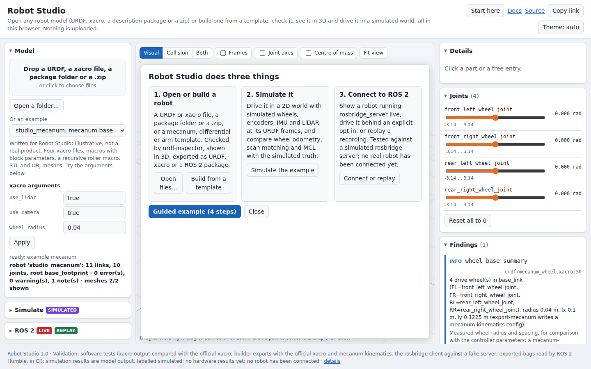
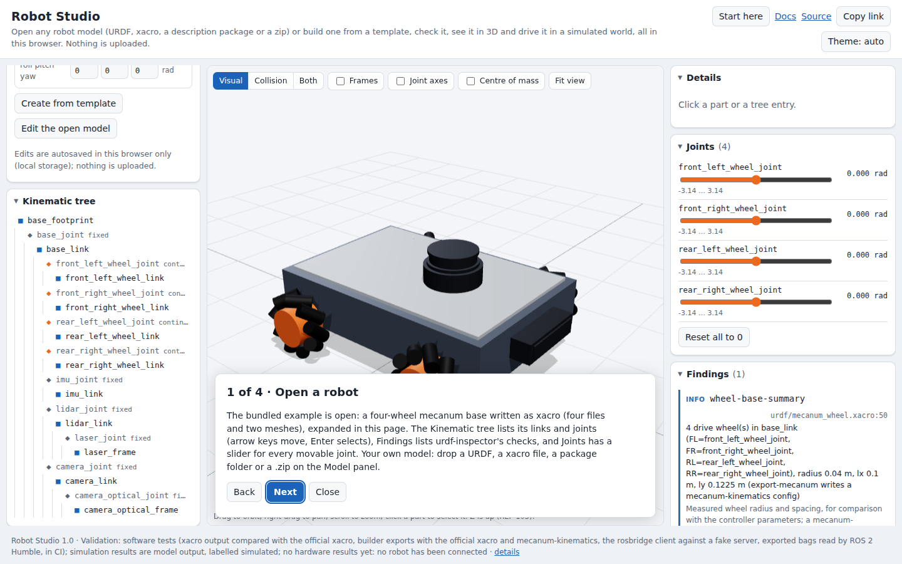
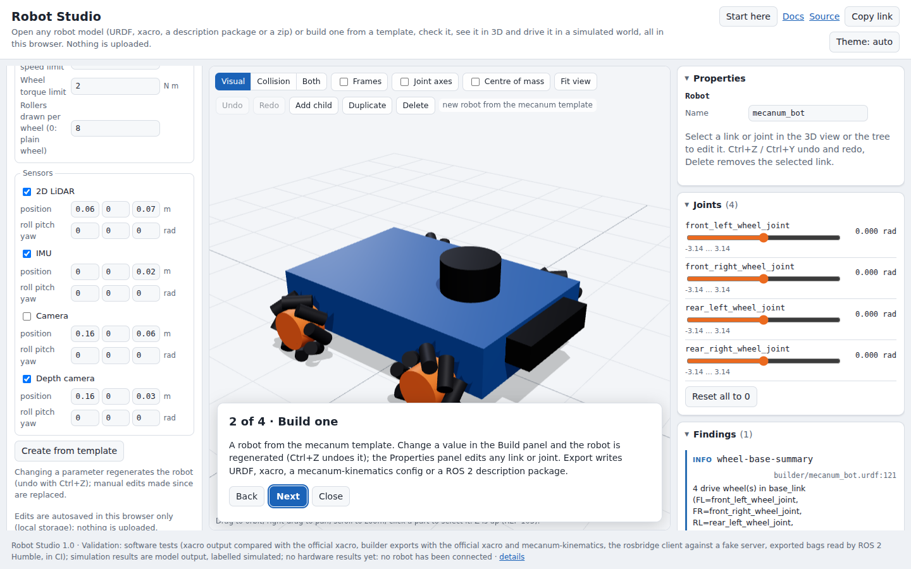
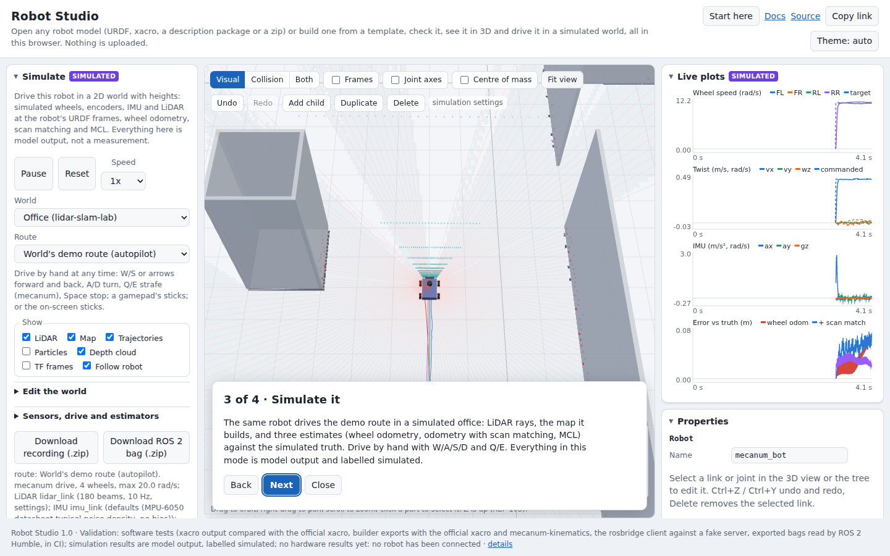
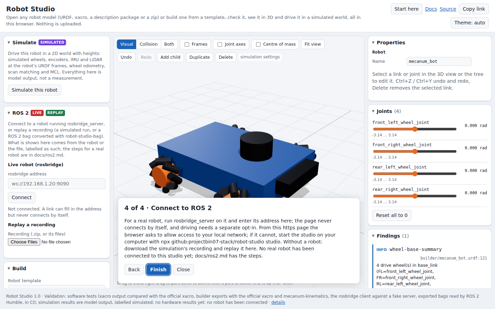

# Getting started

Open <https://projectbin07-stack.github.io/robot-studio/>. On a first visit
(a link without any state) a panel over the 3D view lists the three things
the studio does, each with a button, and offers a guided example. **Close**
hides it for good in this browser; **Start here** in the header brings it
back. Links that carry state (an example, a simulation, a robot address)
open the studio directly.



## The guided example

Four steps, each done in the page itself (Back and Next, or Tab and Enter).

**1. Open a robot.** The bundled studio_mecanum example: four xacro files
and two meshes, expanded in the page. The tree, the findings and the joint
sliders are explained in [model.md](model.md).



**2. Build one.** A robot from the mecanum template; change a parameter and
it is regenerated, Ctrl+Z undoes it, Export writes URDF, xacro, a
mecanum-kinematics TOML or a ROS 2 package ([builder.md](builder.md)).



**3. Simulate it.** The robot drives the demo route in lidar-slam-lab's
office map: LiDAR rays, the map it builds and three estimates against the
simulated truth, all labelled simulated ([simulation.md](simulation.md)).



**4. Connect to ROS 2.** The ROS 2 panel: a robot's rosbridge address, the
opt-in for driving, and replays of recordings. No real robot has been
connected to Robot Studio yet; [ros2.md](ros2.md) has the steps and what
the browser allows from the live site.



## Without the browser

```bash
npx github:projectbin07-stack/robot-studio --help        # the command line (cli.md)
npx github:projectbin07-stack/robot-studio studio        # the page, served from this computer
```

Node 22 or newer. [cli.md](cli.md) has every command with real output.
