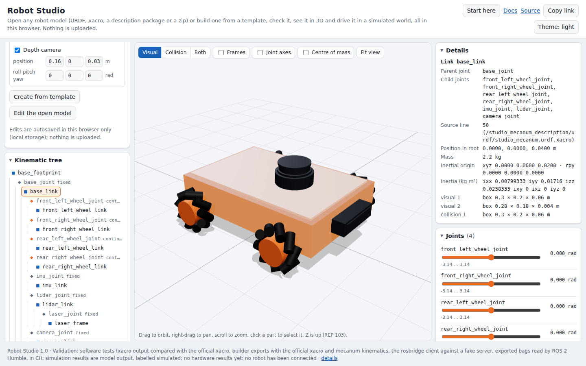
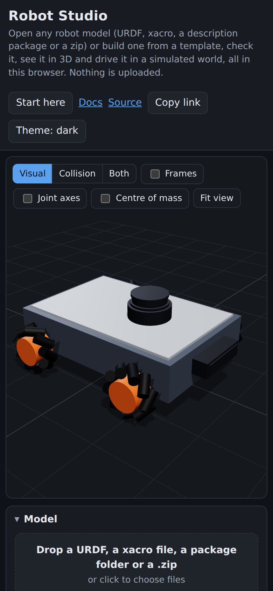

# Opening and checking a model

The viewer half of Robot Studio: open a robot description as it is, see it
in 3D, move its joints and read what urdf-inspector finds wrong with it.
Everything runs in the browser; nothing is uploaded. Validation: software
tests (xacro output compared with the official `xacro`, the bundled
examples opened in headless Chrome in CI); hardware does not apply here.

_Screenshot taken from the live site by the CI job `screenshots` (Pages
workflow) after the 1.0.0 deploy._

## Open a model

- **Drop** a URDF or xacro file, several files, a whole package folder or a
  `.zip` on the Model panel, or click it to choose files. **Open a folder…**
  picks a folder (browsers that support folder upload). Zips are read by the
  page's own zip reader (stored and deflate entries).
- When the drop holds several candidates, the best one opens (a
  `*.urdf.xacro` with a `<robot name=...>`); **File to open** switches.
- `package://name/...`, `$(find name)` and relative mesh paths resolve
  inside what you dropped, from each `package.xml`. A mesh that is not found
  is drawn as a magenta placeholder and reported as `mesh-missing` (a
  urdf-inspector check since its 0.2.0, fed by the page's file lookup).
- **Or an example:** studio_mecanum (written for this project, four xacro
  files, STL and OBJ meshes, illustrative), TurtleBot3 Burger (ROBOTIS,
  Apache-2.0), the ROS URDF tutorial robots (BSD-3-Clause) and
  ros2_control_demos RRBot (Apache-2.0), unmodified and attributed
  ([sources](../tests/corpus/SOURCES.md)).
- **xacro arguments** of the open file get a form; **Apply** re-expands.
  xacro is expanded in the page; what is and is not supported is in
  [xacro.md](xacro.md).

## The 3D view

three.js, Z up (REP 103). Drag to orbit, right-drag to pan, scroll to zoom,
click a part to select its link. The toolbar above the view:

| Control                   | What it does                                                    |
| ------------------------- | --------------------------------------------------------------- |
| Visual / Collision / Both | which geometry is drawn                                         |
| Frames                    | an axis triad at every link frame                               |
| Joint axes                | an arrow along each movable joint's axis, at the joint frame    |
| Centre of mass            | the whole robot's centre of mass at the current joint positions |
| Fit view                  | frame the camera on the robot again                             |

Meshes: STL (binary and ASCII), OBJ (without `.mtl`) and COLLADA (`.dae`,
with colours and textures). Other formats are drawn as placeholders with a
finding.

## Panels

- **Kinematic tree:** links and joints as a tree. Click or press Enter to
  select; arrow keys move through it (see [keyboard](accessibility.md)).
- **Details:** for a link, its parent and child joints, the file and line
  it was defined in, its pose in the root frame at the current joint
  positions, mass, inertia and every visual and collision; for a joint, its
  type, origin, axis, limits and mimic.
- **Joints:** one slider per movable joint within its limits (continuous
  joints ±π, prismatic joints in metres); mimic joints follow their source.
  The poses come from urdf-inspector's forward kinematics.
- **Findings:** urdf-inspector's 73 checks on the expanded model, sorted by
  severity, plus xacro errors and warnings and meshes the view could not
  read. Each names the file and line it came from (the file comes from
  urdf-inspector since 0.2.0) and selects its link or joint.
- **Expanded URDF:** the URDF the checks ran on, with a download button.

## Links, themes, phone

**Copy link** puts the example, xacro arguments, joint positions, selection,
view options, theme, an open simulation (world, route, settings) and a
rosbridge address in the URL; a link never connects to a robot by itself.
Files you opened yourself are never put in a link. **Theme** cycles
automatic, light and dark. Below 760 px the panels stack under the 3D view.

## Large models

Performance budget (milestone 5): a generated package with 200 links and
200 binary STL meshes of 5100 triangles each (51.0 MB of meshes, a 51.2 MB
zip; `scripts/large-model.mjs`, not committed) must open in under 10 s in
the CI browser job, from handing the zip to the page until the model and
all its meshes are shown. Measured:

| Where                                                               | Open time |
| ------------------------------------------------------------------- | --------- |
| CI browser job, headless Chrome 157 on `ubuntu-latest`, SwiftShader | 2.81 s    |
| Development machine (Windows 11), headless Edge 158, SwiftShader    | 2.43 s    |

Every mesh is still loaded at once and there is no level of detail; a
model far beyond this budget will take proportionally longer.

## Limitations

- `xacro.load_yaml`, comprehensions and lambda are not supported
  ([xacro.md](xacro.md#not-supported-honest-list)).
- Floating and planar joints have no sliders (urdf-inspector's FK shows
  them at their origin).
- The camera is framed on rough bounds first and re-framed when the meshes
  have loaded; helper sizes use the rough size.
