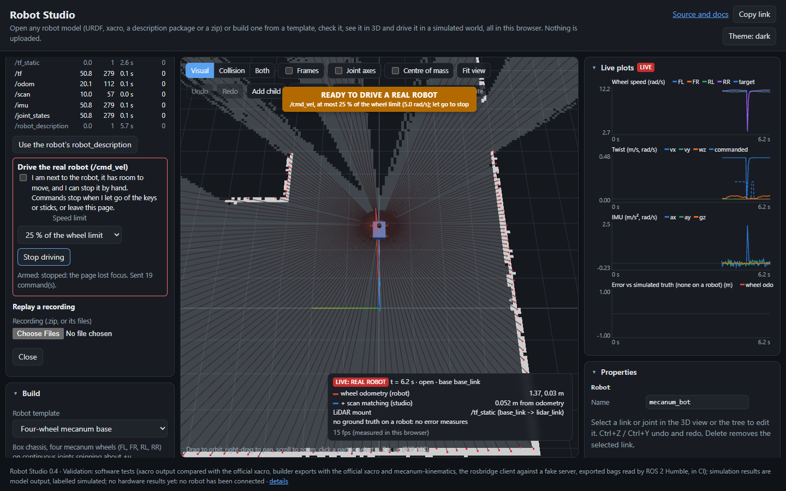
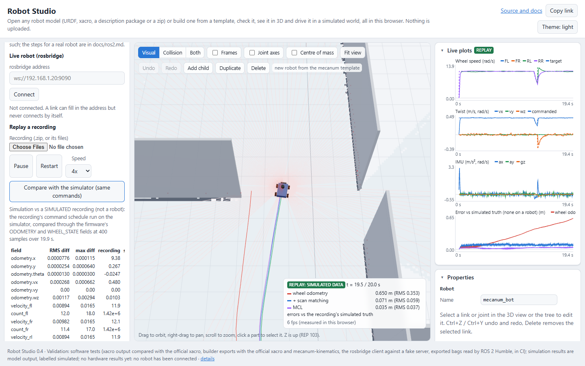

# ROS 2 (milestone 4)

Robot Studio talks to ROS 2 in three ways: a **live robot** over rosbridge
(view its data, drive it from the teleop), **bags** (a simulated run written
as a ROS 2 MCAP bag; a ROS 2 bag turned back into a recording by the Python
companion `robot-studio-bag`) and **replays** of recordings through the same
estimators, 3D layers, plots and HUD as the simulation, with a comparison of
a recording against the simulator driven by the same commands.

**Validation tiers.** Software tests: everything below is tested in CI
against a fake rosbridge server, Robot Studio's own bags, rosbag-inspect and
ROS 2 Humble's own bag tools. Simulation: every bag, replay and comparison
shown in this document comes from simulated runs and is labelled so.
Hardware: **none yet**. No real robot has been connected and no bag from a
robot has been read; the steps for the owner's MentorPi are in
[For the robot's owner](#for-the-robots-owner-mentorpi).

- [Live robot over rosbridge](#live-robot-over-rosbridge)
- [Driving: cmd_vel and the dead-man switch](#driving-cmd_vel-and-the-dead-man-switch)
- [Bag export](#bag-export)
- [Bag import: robot-studio-bag](#bag-import-robot-studio-bag)
- [Replay and simulation vs robot](#replay-and-simulation-vs-robot)
- [For the robot's owner (MentorPi)](#for-the-robots-owner-mentorpi)
- [How it is checked](#how-it-is-checked)
- [Measured performance](#measured-performance)
- [Security](#security)
- [Limitations](#limitations)

## Live robot over rosbridge



The page has its own rosbridge v2 client (`src/core/ros/rosbridge.js`),
written from the protocol specification (rosbridge_suite's
`ROSBRIDGE_PROTOCOL.md`): JSON over a WebSocket, the operations `subscribe`,
`unsubscribe`, `advertise`, `unadvertise`, `publish`, `call_service`, and the
server's `publish`, `service_response`, `status` and `fragment`. It
reconnects with exponential backoff (0.5 s doubling to 8 s) and subscribes
and advertises again after a reconnect.

In the **ROS 2** panel, enter the address of the robot's rosbridge_server
(`192.168.1.20` is completed to `ws://192.168.1.20:9090`) and press
**Connect**. A link can carry the address (`?ros=ws://...`) to fill the
field; it never connects without the click.

| Topic                | Type                         | rosbridge throttle | Used for                                                                      |
| -------------------- | ---------------------------- | ------------------ | ----------------------------------------------------------------------------- |
| `/joint_states`      | `sensor_msgs/msg/JointState` | 50 ms              | joint angles of the model, wheel speeds plot                                  |
| `/tf`                | `tf2_msgs/msg/TFMessage`     | none               | `odom` → base when there is no `/odom`                                        |
| `/tf_static`         | `tf2_msgs/msg/TFMessage`     | none               | the LiDAR's mount (x, y, yaw and height) and the odometry child → base offset |
| `/scan`              | `sensor_msgs/msg/LaserScan`  | none               | LiDAR rays and returns in 3D, scan matching                                   |
| `/imu`               | `sensor_msgs/msg/Imu`        | 20 ms              | IMU plot                                                                      |
| `/odom`              | `nav_msgs/msg/Odometry`      | none               | the robot's pose (wheel odometry trail), twist plot                           |
| `/robot_description` | `std_msgs/msg/String`        | none               | the robot's URDF ("Use the robot's robot_description")                        |

If nothing arrives on `/robot_description`, the button asks rosapi
(`/rosapi/get_param`, name `/robot_state_publisher:robot_description`). The
robot is drawn with the open model; the URDF from the robot opens as a model
whose `package://` meshes show as placeholders unless the description
package is opened from files instead.

What is shown is the robot's own data, under a red **LIVE: real robot**
badge in the HUD and on the plots: the model at the robot's odometry, its
LiDAR returns from the mount `/tf_static` gives, its joints, wheel speeds,
twist and IMU. On top, the studio runs lidar-slam-lab's scan matching on the
robot's odometry and scans (the blue trail and the map); the HUD says how far
it is from the robot's odometry. There is no ground truth on a robot, so no
error measures. The panel's table shows each topic's rate over the last 2 s,
message count, age of the last message and how many messages failed the
checks (hover for the reason).

**The browser has to be allowed to connect.** The live site is served over
https, and browsers block unencrypted `ws://` connections from an https page
to other machines (mixed content); only `ws://localhost` / `127.0.0.1` is
allowed. To reach a robot, either open the studio from a local copy over
http (`node scripts/serve.js`, below), or give rosbridge_server a certificate
and use `wss://` (its `ssl`, `certfile` and `keyfile` launch arguments).
Chromium-based browsers also block a public https page from reaching
local or private addresses (Local Network Access) unless the user allows it
when asked: from the live site, headless Edge refused even
`ws://127.0.0.1:9090` (`net::ERR_BLOCKED_BY_LOCAL_NETWORK_ACCESS_CHECKS`),
and the page warns about this. The local copy avoids both checks. (The
screenshots of the live view were taken from the live site with that check
turned off in the headless browser, `--allow-local-network` in
`scripts/browser-smoke.mjs`, connected to the fake server on the same
machine.)

## Driving: cmd_vel and the dead-man switch

The keyboard (W/S, A/D, Q/E strafe on mecanum bases, Space stop), a
gamepad and the on-screen sticks that drive the simulation also drive a
connected robot: `geometry_msgs/msg/Twist` on `/cmd_vel`
(`src/core/ros/deadman.js`). Nothing is published until:

1. the robot's model is open (its wheels and their velocity limit give the
   speed limit; without it driving is impossible),
2. **"I am next to the robot, it has room to move, and I can stop it by
   hand"** is ticked (it is cleared again after each arming), a speed limit
   is chosen (10, 25, 50 or 100 % of the wheel limit; never more), and
3. **Enable driving** is pressed. A banner then says **READY TO DRIVE A REAL
   ROBOT**, and **DRIVING A REAL ROBOT** while a command is held.

| Event                                                | What is sent                                                                            |
| ---------------------------------------------------- | --------------------------------------------------------------------------------------- |
| a key, stick or pad axis held                        | the command, at once and then every 100 ms                                              |
| every key, stick and axis released                   | a zero Twist at once (in the key-up / pointer-up handler), two more at 100 ms intervals |
| the page loses focus (key-ups are lost)              | zero at once, held inputs forgotten                                                     |
| no input for 250 ms (frozen tab, stalled frame loop) | zero at the next 50 ms tick                                                             |
| the page is hidden or closed                         | zero, and driving is disarmed (needs a new opt-in)                                      |
| the connection drops or reconnects                   | driving is disarmed; nothing can be sent until it is back and re-armed                  |
| "Stop driving"                                       | zero, disarmed                                                                          |

Commands are scaled, keeping their direction, so that no wheel turns faster
than the chosen fraction of the robot's wheel limit, with the firmware's own
inverse kinematics and saturation (`fwInverse`, `saturate`); a differential
base never gets a sideways component.

**A browser cannot stop a robot over a connection that is gone.** If Wi-Fi
drops while a command is held, the robot keeps the last Twist unless its own
driver stops when commands stop arriving. Check that the robot's base
controller has a cmd_vel timeout (or put `twist_mux` with a timeout in
front of it) before driving; the commands are re-sent every 100 ms so such a
timeout can be short (for example 0.5 s).

## Bag export

`robot-studio sim ... --bag DIR`, `robot-studio bag RECORDING_DIR -o DIR`
and the Simulate panel's **Download ROS 2 bag** write a bag directory:
`metadata.yaml` (rosbag2 bag format version 5, as Humble writes it) and one
MCAP file (`src/core/ros/mcap.js`: profile `ros2`, uncompressed chunks of
about 1 MiB with message indexes, chunk indexes, statistics and summary
offsets, every CRC filled in). Messages are CDR (XCDR1, little endian,
`src/core/ros/cdr.js`) with the Humble message definitions embedded as
`ros2msg` schemas (`src/core/ros/msgdefs.js`).

| Topic                   | Type                             | From                         | Notes                                                                                                                        |
| ----------------------- | -------------------------------- | ---------------------------- | ---------------------------------------------------------------------------------------------------------------------------- |
| `/robot_studio/source`  | `std_msgs/msg/String`            | `summary.json`, `world.json` | one JSON message: `simulated: true`, the note, robot frames, world (with its map), seed, sensors                             |
| `/tf_static`            | `tf2_msgs/msg/TFMessage`         | the URDF's fixed joints      | as robot_state_publisher sends them; offered with transient-local durability                                                 |
| `/tf`                   | `tf2_msgs/msg/TFMessage`         | `trajectory.csv` (100 Hz)    | `odom` → the URDF's root frame from the wheel odometry; `map` → `odom` from the scan-matched pose (identity without a LiDAR) |
| `/odom`                 | `nav_msgs/msg/Odometry`          | `odometry.csv` (20 Hz)       | the firmware's ODOMETRY frames, re-expressed from the drive frame (wheel centroid) to the root frame                         |
| `/scan`                 | `sensor_msgs/msg/LaserScan`      | `scans.jsonl`                | no return → `+inf` (REP 117); `angle_max` from the beam count; `time_increment` 0; no intensities                            |
| `/imu`                  | `sensor_msgs/msg/Imu`            | `imu.csv`                    | no orientation (`orientation_covariance[0] = -1`); covariances 0 ("unknown")                                                 |
| `/joint_states`         | `sensor_msgs/msg/JointState`     | `joint_states.csv`           | wheel joint positions and velocities                                                                                         |
| `/cmd_vel`              | `geometry_msgs/msg/Twist`        | `trajectory.csv` `cmd_*`     | the command applied in each 10 ms control period                                                                             |
| `/firmware/wheel_state` | `std_msgs/msg/Float64MultiArray` | `wheel_state.csv` (20 Hz)    | one row of WHEEL_STATE; `layout.dim[0].label` is the CSV header                                                              |
| `/ground_truth`         | `nav_msgs/msg/Odometry`          | `trajectory.csv` `true_*`    | simulated truth of the base frame in `map`; only simulated runs have it                                                      |

Frames: `odom` and `map` are both the robot's start pose. Clock: header
stamps and log times are the recording's time **plus 1 s**, because ROS tools
read a stamp of 0 as "not set" (tf2 as "latest"); the importer subtracts the
bag's start again. The MCAP file also carries a `robot_studio` metadata
record with `simulated: true`.

The bag is read in CI by rosbag-inspect v0.2.0 (`info`, `check`, `export
--arrays`) and by ROS 2 Humble itself (`ros2 bag info`, then every message
deserialized with `rosbag2_py` and `rclpy` into the installed Humble message
classes and compared with the recording; `scripts/ros2_bag_verify.py`).
rosbag-inspect's `check` passes it with no errors or warnings (4 notes: IMU
without orientation, zero covariances, the share of no-return beams, the
cmd_vel response time).

## Bag import: robot-studio-bag

`python/` is a small Python package (`robot-studio-bag`, Python 3.10+,
typed, ruff- and mypy-clean) that turns a ROS 2 bag into the recording
format. It reads bags with
[rosbag-inspect](https://github.com/projectbin07-stack/rosbag-inspect) as a
library, pinned to its **v0.2.0** tag (SQLite3 and MCAP storage, CDR,
message definitions); it contains no storage or CDR code of its own.

```bash
pip install "robot-studio-bag @ git+https://github.com/projectbin07-stack/robot-studio@v0.4.0#subdirectory=python"
robot-studio-bag my_bag/ my_recording/          # --scan-topic, --odom-topic, --base-frame, ... to change names
node bin/robot-studio.js replay my_recording/   # or zip the folder and open it in the ROS 2 panel
```

- **LaserScan**: every beam is kept, in order. `+inf`, `-inf`, `NaN` and
  values below `range_min` or above `range_max` become `null`, "no return";
  the importer notes how many of each it saw. Scans whose beam count or
  angles differ from the first are skipped with a note.
- **LiDAR mount**: the pose of the scan's frame in the base frame, looked up
  through `/tf_static` (any chain, 3D), written to the scans header as x, y,
  z and yaw; the studio casts the rays from there and the estimators use it.
  Without a path the header says so and the LiDAR is taken to be at the
  base.
- **Odometry**: one trajectory row per `odom` → base transform on `/tf` (or
  per `/odom` message), moved by the static offset between the odometry's
  child frame and the base frame; `map` → `odom` gives `est_*`; `/cmd_vel`
  is held between messages; `true_*` only from a simulator's
  `/ground_truth`. `/odom` also becomes `odometry.csv` in the firmware's
  layout.
- Times are seconds from the bag's start, from header stamps (receive time
  when a stamp is 0).
- **Labels**: `summary.json` says `source.simulated: true` only when the bag
  carries Robot Studio's `/robot_studio/source` saying so; everything else
  is "recorded data".

rosbag-inspect needed one fix for this, made there and released as
**v0.2.0** (ecosystem audit finding 20): `export --arrays` keeps every
LaserScan beam (and every numeric array) instead of only its length, `echo
--nonfinite null` writes non-finite values as JSON null, and an optional
`zstd` extra reads zstd-compressed bags on Python 3.10-3.13 (part of finding
54).

## Replay and simulation vs robot



**Replay** (`src/core/ros/replay.js`, `robot-studio replay`, the panel's
"Replay a recording"): the recording's streams are merged in time order and
fed to the same `Track` a live robot uses: lidar-slam-lab's scan matching on
the recorded wheel odometry and, when the recording has a world, MCL on its
floor plan; error measures only against a simulated recording's truth. The
3D view, plots and HUD carry a green **Replay** badge, "SIMULATED data"
when the file says so.

**Simulation vs robot** (`src/core/ros/compare.js`, `robot-studio compare`,
the panel's "Compare with the simulator"): the recording's commanded twist
(its `/cmd_vel`) is held per 10 ms control period and run on the simulator
with the open robot (the recording's world and seed when it has them, else
the empty world), then both runs are compared at the recording's telemetry
times through the firmware's ODOMETRY fields (x, y, theta, vx, vy, wz) and
WHEEL_STATE (wheel speeds and encoder counts), or the JointState wheel
velocities when a recording has no wheel telemetry.

No robot bag exists yet, so this is demonstrated with a bag produced by the
simulator (labelled so everywhere). 60 s of the mecanum template in the
office (seed 1), exported, imported, then compared with the same robot
(measured on the development machine, Windows 11, Node 25):

```
SIMULATION vs a SIMULATED recording (not a robot): the recording's command schedule run on the simulator
compared  1200 ODOMETRY samples over 59.95 s; 1200 WHEEL_STATE samples
field            RMS diff   max diff   final (recording / simulation)
odometry.x          0.0001     0.0001   10.9481 / 10.9482
odometry.theta      0.0000     0.0001   -2.2142 / -2.2141
odometry.wz         0.0012     0.0029   -1.4991 / -1.4977
wheel_state.velocity_fl    0.0094     0.0165   8.4492 / 8.4327
wheel_state.count_fl   21.8308    39.0000   3789350.0000 / 3789390.0000
```

(rows abridged). The remaining difference is the recording's commands
being written with 4 decimals. With `--ideal` (no motor lag, no slip, no
radius error) the same commands end 1.89 m away at most in x (RMS 0.68 m)
and the wheel speeds differ by up to 13.6 rad/s right after each command
step: the comparison shows a model that does not match. On a robot's bag
the same table compares the simulator with the real drive.

## For the robot's owner (MentorPi)

The hardware tier is empty until these steps are done once and recorded in
the README (date, commit, what was seen). Nothing below has been run on the
MentorPi yet; topic names and frames may differ on it, so check each step.

**On the robot** (ROS 2 Humble):

```bash
sudo apt install ros-humble-rosbridge-suite          # rosbridge_server and rosapi
# start the robot as usual (base driver, LiDAR, IMU, robot_state_publisher), then:
ros2 launch rosbridge_server rosbridge_websocket_launch.xml     # ws://<robot-ip>:9090
ros2 topic list                                      # expect /scan /odom /imu /tf /tf_static /joint_states /cmd_vel
ros2 topic info /cmd_vel                             # geometry_msgs/msg/Twist expected
```

The studio uses the names in the table above. If the robot's differ (for
example its base listens on `/controller/cmd_vel`), relay them:
`sudo apt install ros-humble-topic-tools`, then
`ros2 run topic_tools relay /cmd_vel /controller/cmd_vel` (and likewise for
sensor topics, in the other direction).

**On a laptop on the same network** (Node 22 or newer; the live site cannot
reach `ws://` on the robot, see above):

```bash
git clone --branch v0.4.0 https://github.com/projectbin07-stack/robot-studio.git
cd robot-studio
node scripts/serve.js                                # http://127.0.0.1:8000/
```

1. Open `http://127.0.0.1:8000/?ros=ws://<robot-ip>:9090`, open the ROS 2
   panel and press **Connect**. The topic table should show rates for every
   topic; the HUD says LIVE.
2. Press **Use the robot's robot_description** (or open the MentorPi's
   description package folder with "Open files", which also brings its
   meshes). Check that the LiDAR returns line up with the walls and that
   the table's "rejected" column stays 0.
3. Before driving, lift the robot so its wheels are off the ground, and
   check that its base stops on its own when `/cmd_vel` stops (publish one
   Twist with `ros2 topic pub --once /cmd_vel geometry_msgs/msg/Twist "{linear: {x: 0.05}}"`
   and see whether the wheels stop within a second). Then tick the
   confirmation, choose **10 %**, press **Enable driving**, hold W briefly,
   let go: the wheels must stop. Only then drive on the floor.
4. Record a bag of a short drive with a known command schedule:
   `ros2 bag record -o mentorpi_run /scan /odom /imu /tf /tf_static /joint_states /cmd_vel /robot_description`
   (Humble writes SQLite3 by default; `-s mcap` works too, and if its chunks
   are zstd-compressed install `"rosbag-inspect[zstd]"` on Python 3.10-3.13).
5. Import and replay it: `pip install` robot-studio-bag as above, then
   `robot-studio-bag mentorpi_run/ mentorpi_rec/` (`--base-frame
base_footprint` if the odometry's child frame is not the base), then
   `node bin/robot-studio.js replay mentorpi_rec/`, or zip the folder and
   open it in the panel.
6. Compare with the simulator: `node bin/robot-studio.js compare
mentorpi_rec/ <the MentorPi's URDF or xacro>`.
7. Add to the README's hardware tier: the date, the Robot Studio commit,
   the robot's software versions, and what was observed (rates, whether the
   LiDAR lined up, the dead-man stop, the comparison table). Keep the bag if
   it can be shared.

## How it is checked

Software tests (node:test, Ubuntu and Windows, Node 22 and 24):

- `tests/rosbridge.test.js`, against `scripts/fake-rosbridge.mjs` (an RFC
  6455 server written on `node:http`) replaying message fixtures generated
  from a simulated run (`tests/fixtures/rosbridge/`, rosbridge's JSON form
  with both `null` and the bare `Infinity` token for no-return beams):
  subscriptions with types and throttles, the LiDAR mount from `/tf_static`
  equal to the URDF's, scans, joints, robot_description by topic and by
  rosapi, service errors; malformed JSON, an oversized message, a binary
  frame, an unknown op, invalid fields, fragments (in any order, bad ones
  dropped) all counted and dropped while the client keeps working;
  reconnect with subscriptions and adverts sent again and driving disarmed;
  the dead-man switch on a fake clock (nothing before the opt-in, 100 ms
  rate, zero on release in the same call and twice more, stale input at
  250 ms, blur, hidden, the speed limit at exactly the chosen fraction of
  the wheel limit) and over a real connection (the zero reaches the server
  within 100 ms of the release).
- `tests/ros-bag.test.js`: CDR bytes checked by hand (alignment after the
  header, strings, sequences, fixed arrays), the definitions, the MCAP
  writer (every CRC, chunk and message indexes, statistics, metadata), the
  whole topic mapping decoded back, the differential template's drive
  offset, the recording reader's limits.
- `tests/ros-replay.test.js`, `tests/ros-cli.test.js`: replay with and
  without truth, the command schedule and comparison, the CLI.
- The browser job drives the page against the fake server: connect by
  click, LIVE badge, arming refused without the confirmation, W held then
  released then held and the window blurred; the fake server's log must show
  `/cmd_vel` advertised before any Twist, moving Twists, a zero after the
  release and after the blur, and a zero last. It also replays a recording
  zip and runs the comparison.

Python companion (Ubuntu and Windows, Python 3.10 and 3.13): ruff, mypy
strict, pytest with coverage over 85 % (97 % measured locally): Robot
Studio's own MCAP export of a simulated run imports to exactly the
recording it came from; a hand-made robot-like SQLite3 bag checks the
no-return rules, the mount through a two-joint `/tf_static` chain with a
LiDAR turned 180 degrees, `/odom`-only bags and wrong topic types.

CI jobs `bag-roundtrip` and `ros2-bag`: see [Bag export](#bag-export). The
round trip of a 60 s simulated run (mecanum, office, seed 1; development
machine) compared every value of every stream: all 6000 trajectory rows
(except MCL, which is the studio's and not in the bag), 6000 IMU and joint
rows, 1200 ODOMETRY and WHEEL_STATE frames and 108180 LiDAR beams (13482 of
them no return in both) are equal to the precision the files are written
with (maximum difference 0), and replaying the original and the imported
recording gives identical estimator results (wheel odometry RMS 0.746 m,
scan matching 0.054 m, MCL 0.034 m against the simulated truth). The
differential template (20 s, lab, seed 2; drive frame 5 cm from
`base_link`) also round-trips with every difference 0.

## Measured performance

All on the development machine (Windows 11, Node 25.8, Python 3.14), except
where a CI runner is named.

| What                                                                                                                       | Measured                                                         |
| -------------------------------------------------------------------------------------------------------------------------- | ---------------------------------------------------------------- |
| bag export of a 60 s run (33003 messages)                                                                                  | 0.72 s for the whole `robot-studio bag` command; 12.3 MB of MCAP |
| `robot-studio-bag` import of that bag                                                                                      | 2.7 s                                                            |
| replay of 60 s through scan matching and MCL (`robot-studio replay`)                                                       | 7.1 s (8.5x real time)                                           |
| release → zero Twist at the server (dead-man, loopback WebSocket, 50 releases, client and fake server in one Node process) | median 0.21 ms, max 0.53 ms                                      |
| release → zero in the headless browser scenario (fake server's log, time since the last moving Twist)                      | 87 ms and 76 ms (both within one 100 ms send period)             |
| live view frame rate, headless Edge with SwiftShader (software WebGL)                                                      | 18 fps; not a measure of a real GPU                              |

## Security

- The address is user input: only `ws://` and `wss://`, no user name or
  password, no fragment, at most 512 characters; a link only pre-fills it.
- Every incoming message is untrusted: size-checked (8 MiB) before parsing,
  parsed by `JSON.parse` or, for rosbridge's bare `NaN` / `Infinity`
  tokens, by a strict JSON reader with a depth limit (no `eval`), checked
  per operation and per message type (types, finite numbers, at most 256
  joints, 512 transforms, 100000 beams, 256-character names, 8 M-character
  robot_description), and dropped and counted when it fails. Binary frames,
  `png` and unknown ops are dropped. Text from messages reaches the page only
  through `textContent`.
- A robot_description is opened like a URDF file the user opens (checked by
  urdf-inspector, nothing in it is executed), and only on a click.

## Limitations

- **No hardware validation**: no real robot, no bag from one.
- Topic names are fixed (`/scan`, `/odom`, ...); relay other names on the
  robot. `/cmd_vel` is `geometry_msgs/msg/Twist` (Humble); a robot that
  wants `TwistStamped` needs a relay.
- Only one LiDAR; depth images and point clouds from a robot are not shown.
- The live view runs scan matching on the robot's odometry but not MCL
  (there is no floor plan of a real room); `map` → `odom` from the robot's
  own SLAM or AMCL is not drawn.
- Replays track the base frame. For a base whose wheel centroid is off
  `base_link` (the differential template), MCL in a replay is worse than in
  the simulation, which tracks the wheel centroid (0.2 m RMS against
  0.024 m for scan matching on the 20 s lab run): lidar-slam-lab's motion
  model reads an offset frame's turn as two rotations
  ([decisions.md](decisions.md), 15).
- The bag has no intensities, no `/clock`, no camera topics, and its IMU
  covariances are 0 ("unknown").
- The browser buffers a WebSocket message before the client can check its
  size: the 8 MiB limit protects parsing, not memory.
