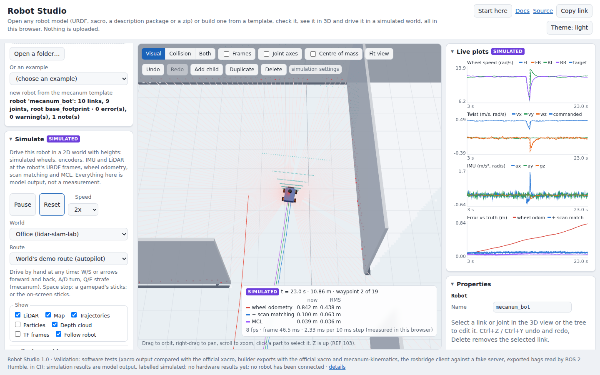

# Simulation

Robot Studio drives the robot you opened or built in a 2D world with
heights, simulates its wheels, encoders, IMU, 2D LiDAR and (optionally) a
depth camera at the robot's own URDF frames, runs wheel odometry, scan
matching and Monte Carlo localisation on the simulated data, and compares
them with the simulated ground truth.

**Everything on this page is model output.** The motor, slip, noise and
bias parameters are made-up defaults (each is named below with where it
comes from) or values you give; none of it is a measurement of a real
robot, and agreement between the simulator and other projects' models is
agreement between models, not validation against hardware. Every panel,
plot, export and CLI report in the studio says "simulated".



_Screenshot from the live site (Pages workflow, `screenshots` job)._

- [How a step works](#how-a-step-works)
- [The robot, read from the URDF](#the-robot-read-from-the-urdf)
- [Drive, encoders and odometry](#drive-encoders-and-odometry)
- [Sensors](#sensors)
- [Estimators](#estimators)
- [Worlds, routes and teleop](#worlds-routes-and-teleop)
- [Command line](#command-line)
- [Recording format and the ROS 2 bag mapping](#recording-format-and-the-ros-2-bag-mapping)
- [Settings](#settings)
- [How it is checked](#how-it-is-checked)
- [Performance](#performance)
- [Limitations](#limitations)

## How a step works

The simulation runs in fixed steps of 10 ms, one control period of
[encoder-odometry-firmware](https://github.com/projectbin07-stack/encoder-odometry-firmware)
(100 Hz), with the motors integrated in 10 sub-steps. It never reads the
clock, and every random number comes from a seeded generator (lidar-slam-lab's
`createRng`, one stream per noise source), so the same seed gives the same
run, byte for byte, on every platform CI runs on.

```
twist command (base frame, like cmd_vel)
  -> firmware mirror: inverse kinematics, direction-preserving saturation,
     per-wheel PI(D) with feed-forward, anti-windup and slew limit -> duty
  -> plant: first-order motor per wheel -> wheel angle -> 4x encoder counts
     (edge times interpolated within the sub-step)
  -> ground speed = wheel speed x (1 + radius error) x (1 - slip)
  -> forward kinematics over the measured wheel positions -> body twist
  -> pose on SE(2) (exponential map), stopped by obstacles
  -> IMU at its link (every 10 ms by default)
  -> every 1/rate s: LiDAR scan from its link, estimator update
```

Code: `src/core/sim/` (DOM-free, tested in Node, coverage-gated):
`firmware.js`, `plant.js`, `robot.js`, `world.js`, `imu.js`, `depth.js`,
`estimators.js`, `sim.js`, `routes.js`, `settings.js`, `record.js`,
`session.js` (the page's real-time wrapper), `reference.js`
(lidar-slam-lab's own experiment for the cross-check). The page wiring is
`src/ui/simui.js`, `simview.js`, `plots.js` and `worldedit.js`.

## The robot, read from the URDF

`simRobot()` (`robot.js`) takes the checked model and the editable document:

- **Drive wheels** are found and measured by the vendored urdf-inspector
  (`measureWheels`: continuous joints named `*wheel*` or with a cylinder
  child, casters excluded). Four wheels, one per corner, make a **mecanum**
  base; two make a **differential** base; anything else is reported as not
  drivable. Each wheel's joint axis must be within 5° of the base's y axis;
  its sign (`lateralSign`) maps wheel speed to joint velocity, so the wheels
  turn the right way in the 3D view and in `joint_states`.
- **Wheel speed limit**: the smallest wheel `<limit velocity>`; without one,
  the firmware's default `max_wheel_speed` (25 rad/s), with a note.
- **Frames**: the planar pose is reported for the base frame (`base_link`
  when present) projected on the floor. The kinematics work in the _drive
  frame_: the base frame moved to the wheel centroid (the centre of rotation;
  5 cm ahead of `base_link` on the differential template). The base frame's
  height above the floor puts the wheels on the floor.
- **Sensors** are the links tagged in the document (`lidar2d`, `imu`,
  `depth_camera`; guessed from link names on import). Their poses in the
  base frame come from urdf-inspector's forward kinematics at the zero
  configuration; nothing is hard-coded. A LiDAR whose z axis is more than 5°
  from vertical is reported and not simulated; a tilted IMU sees gravity on
  its x and y axes as a real one would.
- **Gazebo `<sensor>` tags** on a sensor link (top-level
  `<gazebo reference="...">`) set the LiDAR's samples, angles, range, noise and
  update rate and the IMU's noise and bias, unless switched off in the
  settings. Both the SDF 1.6 per-axis IMU noise and the older
  `<noise><rate>/<accel>` spelling are read, including IMU noise given to a
  `gazebo_ros_imu` plugin for a link (TurtleBot3 Burger does this).
- **Footprint** for collisions: a disc around the wheel centroid through the
  farthest corner of any collision primitive (meshes are not measured).

## Drive, encoders and odometry

The drive mirrors encoder-odometry-firmware v0.1.0 so the simulated robot
reports what that firmware would report, in the same units and fields
(`firmware.js` follows `lib/odocore` and its Python model
`host/src/odobridge/firmware_model.py` class by class):

| Part               | Model                                                                                                                                                   | Default                                                                                                 |
| ------------------ | ------------------------------------------------------------------------------------------------------------------------------------------------------- | ------------------------------------------------------------------------------------------------------- |
| Inverse kinematics | firmware's formulas: mecanum with roller angle 45° and k = ly + lx tan(α); differential with half the wheel separation                                  | geometry measured from the URDF                                                                         |
| Saturation         | all four targets scaled by one factor so none exceeds `max_wheel_speed` (as the firmware and mecanum-kinematics do)                                     | URDF limit                                                                                              |
| Velocity estimate  | blended fixed-period / period (1/T) estimator from encoder counts and edge times                                                                        | 200 / 800 counts/s blend, 250 ms zero timeout (firmware defaults)                                       |
| Wheel loop         | PI(D): u = kff·target + ks·sign + kp·e + I + kd·d(−measured)/dt, conditional integration, slew limit                                                    | kp 0.02, ki 0.2, kd 0, kff 0.03, slew 4 duty/s (firmware defaults)                                      |
| Watchdog           | targets to zero after 500 ms without a command                                                                                                          | (the simulator commands every period)                                                                   |
| Motor + gearbox    | first order, wheel side: steady state (\|u\| − deadband)/k, time constant τ                                                                             | k 0.034 duty per rad/s, deadband 0.06, τ 0.08 s: the firmware model's made-up numbers                   |
| Encoder            | ideal quadrature, 4x decoding, exact edge times                                                                                                         | 500 lines × 4 × 19:1 = 38000 counts per wheel revolution (the firmware's default `ticks_per_wheel_rev`) |
| Slip               | per wheel, first-order Gauss–Markov fraction of the wheel's speed, updated every period                                                                 | std 0.02, correlation time 0.5 s                                                                        |
| Wheel radius error | true radius = nominal × (1 + e), left and right                                                                                                         | +0.3 % left, −0.3 % right (invented, so dead reckoning drifts in heading)                               |
| Body motion        | least-squares forward kinematics over the measured wheel positions (mecanum; drive.js), axle formula (differential); SE(2) exponential map per sub-step |                                                                                                         |
| Collisions         | lidar-slam-lab's `collides()` for the footprint disc against every obstacle; a blocked step keeps the rotation, the wheels keep turning                 |                                                                                                         |
| Wheel odometry     | the firmware's: forward kinematics of encoder increments, composed on SE(2) every period                                                                |                                                                                                         |

_Ideal wheels_ (a setting, `--ideal` in the CLI) replace the motor and PI
loop by wheels that turn at the commanded speed at once, with no slip or
radius error: used for the analytic tests.

A two-wheel differential base fills the firmware's four slots the way its
differential mode reads them: the left wheel in FL and RL, the right wheel
in FR and RR.

## Sensors

**2D LiDAR** (first level link tagged `lidar2d`). Rays are cast by
lidar-slam-lab's `simulateScan` (Gaussian range noise, random dropouts) from
the LiDAR link's position and yaw, against the obstacles **taller than the
LiDAR's height above the floor** (a box lower than the scan plane is not
seen, but the robot still collides with it). Returns closer than the
minimum range are dropped. A partial fan from a Gazebo tag is centred where
the tag puts it (`angle_min`, `angle_increment` in the recording).
Defaults: lidar-slam-lab's (180 beams over 360°, 8 m, 0.02 m noise, 3 %
dropouts) plus 0.12 m minimum range and 10 Hz.

**IMU** (first link tagged `imu`). Specific force (acceleration minus
gravity, g = 9.80665 m/s²) and angular rate of the IMU link in its own frame:
the acceleration is the second difference of the link's position over the
last two periods (centripetal acceleration of an off-centre IMU included),
rotated by the base yaw and the link's mounted orientation. Error model, in
order of priority:

1. **imu-calibration-lab JSON** (file input in the page, `--imu-cal` in the
   CLI): the page's combined export (`{ accel, gyro, mag }`), single CLI
   results (`"kind": "accel" | "gyro" | "allan"`) or an array of them. Its
   accelerometer calibration is `a_cal = M (a_raw − b)` (in g), so the
   simulated raw reading is `a_raw = M⁻¹ a + b`; its gyroscope calibration
   `w_cal = (w_raw − bias) / scale` (deg/s) gives `w_raw = scale · w + bias`;
   white noise from the gyroscope's static `noiseStd` or an Allan analysis'
   `noiseDensity`, and bias random walk from the Allan `rateRandomWalk` (K)
   term. Units are converted to SI.
2. Gazebo IMU noise and bias on the link (per-sample std, converted to a
   density at the IMU rate).
3. Defaults: zero bias, unit scale, white noise at the MPU-6000/6050 product
   specification's typical densities (gyroscope 0.005 °/s/√Hz,
   accelerometer 400 µg/√Hz).

**Wheel encoders**: see the drive above; counts, measured speed, target and
duty per wheel at 20 Hz (the firmware's telemetry rate).

**Depth camera** (lower priority, first link tagged `depth_camera`): a
32 × 24 pinhole grid (70° horizontal field of view, 5 m) cast from the
camera link along its +x axis against the floor and the obstacles at their
heights, at 2 Hz, drawn as a point cloud. No noise, no image, not recorded.
It shows what the LiDAR misses: low obstacles below its scan plane.

## Estimators

All three run on the simulated data through the vendored lidar-slam-lab
modules, as lidar-slam-lab itself does (`estimators.js`):

- **Wheel odometry**: the firmware's dead reckoning.
- **Odometry + scan matching**: each scan is matched (`matchScan`,
  correlative search on a likelihood field) against the occupancy grid built
  so far from the estimate itself (`integrateScan`).
- **MCL** (`mcl.js`): a particle filter on the known floor plan (the
  obstacles the LiDAR can see), started around the true start pose, with
  lidar-slam-lab's motion noise. Since 1.0: lidar-slam-lab's
  omnidirectional motion model on mecanum bases (setting
  `estimators.mclOmni`), augmented-MCL recovery (random particles when the
  fit drops) off while tracking (`estimators.mclRecovery`), and the
  estimate taken before resampling (lidar-slam-lab 0.2.1).

The estimators track the drive frame (the robot's centre of rotation). The
LiDAR sits where the URDF puts it: since lidar-slam-lab 0.2.0 a scan carries
its sensor's pose in the robot frame (`scan.origin`), and the grid, scan
matching and MCL cast its beams from there (ecosystem audit finding 27).
Up to 0.4 the studio re-expressed every scan from the drive frame's origin
instead, so the map's free-space rays started at the robot's centre.
(Tracking the LiDAR's own pose had been tried first and failed: a turn on
the spot moves an offset LiDAR a few millimetres sideways, which the
rot1-trans-rot2 model reads as two large rotations.) With the LiDAR at the
origin and lidar-slam-lab's own MCL settings, the call sequence is exactly
lidar-slam-lab's `sim.js` step, which a test checks number for number.

What the 1.0 changes did, before (0.4.0) and after, MCL position RMS for
seeds 1 to 8, measured on the development machine with the CLI:

| Run                                            | 0.4.0                                             | 1.0                                               |
| ---------------------------------------------- | ------------------------------------------------- | ------------------------------------------------- |
| TurtleBot3 Burger, loop, demo, 60 s            | 5.956 0.187 2.435 0.231 7.123 7.438 0.174 0.129 m | 0.088 0.068 0.109 0.129 0.089 0.168 0.067 0.063 m |
| TurtleBot3 Burger, loop, demo, 20 s, seed 1    | 5.455 m                                           | 0.120 m                                           |
| mecanum template, lab, square (strafes), 40 s  | 0.231 to 0.237 m                                  | 0.017 to 0.030 m                                  |
| differential template, lab, square, 40 s       | 0.131 to 0.155 m                                  | 0.027 to 0.075 m                                  |
| mecanum template, office, demo, 60 s           | 0.032 to 0.040 m                                  | 0.032 to 0.043 m                                  |
| replay of a differential lab run, 20 s, seed 2 | 0.200 m (scan matching 0.024 m)                   | 0.021 m (scan matching 0.022 m)                   |

Why: with recovery on, augmented MCL replaced particles with random ones
whenever the fit dropped, and in the corridor loop with TurtleBot3's 3.5 m
LiDAR and its heading drift some landed on a similar-looking place and won
(turning recovery off alone gives the 1.0 TurtleBot3 numbers). On the lab
squares the error stayed at the same value for every seed: the reported
pose was taken after resampling, when the injected particles counted fully
in the mean; lidar-slam-lab 0.2.1 takes it before resampling (with recovery
on and that fix, the mecanum square is 0.024 to 0.033 m). The
omnidirectional model matters most without good measurements: predicting
1 m of backward driving in 2 cm steps, rot1-trans-rot2 leaves the particle
mean at -0.37 m with a 1.0 m spread, the body-frame model at -1.00 m with
0.01 m (lidar-slam-lab's test); in these runs it changes the mecanum
numbers by a few millimetres. Scan matching moved by up to ±0.03 m RMS per
seed because the map's free-space rays now start at the LiDAR (office demo,
seeds 1 to 8: 0.052 to 0.098 m before, 0.052 to 0.090 m after). Recovery
stays available for a robot that may be kidnapped (`estimators.mclRecovery`);
with `estimators.mclGlobal` the particles start spread over the map.

Error measures (position error of each estimate against the truth, current,
RMS over all scans, maximum) are taken at the drive frame. The odometry the
estimators use is the firmware's, sampled at the start of each control
period, so it is up to 10 ms older than the scan.

## Worlds, routes and teleop

A world is lidar-slam-lab's map format (rectangle, wall segments, start
pose, demo route) plus heights: `wallHeight` for every wall, and boxes
(`x, y, w, d, yaw, h`) and cylinders (`x, y, r, h`; a circumscribed
24-gon for the ray caster), so lidar-slam-lab still reads the files.
Bundled: lidar-slam-lab's **office**, **warehouse** and **loop** (taken from
the vendored `maps.js`, 2 m walls), Robot Studio's **lab** (boxes and
cylinders from 4 cm to 1.2 m high) and an **empty** room.

Edit the world in the Simulate panel (walls, boxes, cylinders, erase, start
pose and heading, route waypoints), save and load it as JSON. The world, the
route and the settings that differ from the defaults are kept in the link
(`sim=1&w=…&r=…&ss=…`; an edited world is written compactly, numbers in
millimetres) and, while editing a robot in the builder, in the robot
document (autosaved and undoable, never written to the URDF). An IMU
calibration file is not put in links.

Routes: **demo** (the world's waypoints, followed by lidar-slam-lab's
autopilot using the true pose, like lidar-slam-lab, so different estimator
settings drive the same path), **square** (open loop: forward, strafe left,
backward, strafe right on a mecanum base; forward and 90° turns on a
differential one), **spin** (two turns on the spot) and **none**. Speeds stay
within 60 % of what the wheels can do.

Teleop overrides the route while held: W/S or ↑/↓ forward and back, A/D or
←/→ turn, Q/E strafe (mecanum), Space stop; a gamepad's left stick (drive)
and right stick (turn); on touch screens two on-screen sticks.

In the 3D view: the world, the robot placed by the simulated pose with its
wheels turned by the wheel joint positions, LiDAR rays and returns from the
LiDAR link, the occupancy map built from the estimate, trajectories (truth
green, wheel odometry red, + scan matching blue, MCL purple), MCL
particles, the depth point cloud, the `map` and `odom` frames and the URDF
link frames (TF), and a camera that follows the robot. The HUD shows the
errors, the frame rate and the measured step time; the plots show wheel
speeds (measured and target), commanded and actual twist, IMU and the
estimators' errors over the last 20 s.

## Command line

```console
$ node bin/robot-studio.js sim mecanum --world office --route demo --seconds 60 --seed 1 --out run/
SIMULATION: model output of Robot Studio's drive, sensor and estimator models; not a measurement.
robot     mecanum_bot: mecanum, 4 wheels, r 0.040 m, lx 0.100 m, ly 0.125 m, max 20.0 rad/s
world     Office; route demo (waypoint 8 of 19); 60.0 s simulated, seed 1
sensors   LiDAR lidar_link: 180 beams, 10.0 Hz, 0.12-8.0 m (settings)
          IMU imu_link: 100 Hz, defaults (MPU-6050 datasheet typical noise density, no bias)
          encoders: 38000 counts per wheel revolution (4x), firmware control loop 100 Hz
motion    25.99 m driven, 0 blocked step(s), 0 saturated step(s)
position error   final     RMS       max
wheel odometry     1.350 m   0.746 m   1.350 m
+ scan matching    0.044 m   0.062 m   0.083 m   (100.0 % of matches accepted)
MCL (300 particles) 0.037 m   0.034 m   0.045 m
step time 1.487 ms per 10 ms step (6.7x real time; measured on this machine, not written to the files)
wrote     run/ (10 files)
```

(The step time line is from the development machine, with a ROS 2 bag
written in the same run; every other line is identical on every CI
platform, which compare a golden digest of the files.)

```
robot-studio sim <robot.urdf|robot.xacro|template> [options]
  --world W            office, warehouse, loop, lab, empty (default office) or a world .json
  --route R            demo, square, spin, none (default demo)
  --seconds S          simulated time (default 60, at most 3600)
  --seed N             random seed (default 1)
  --out DIR            write the recording (below)
  --imu-cal FILE       imu-calibration-lab JSON export as the IMU error model
  --set key=value      a setting, e.g. lidar.beams=360, drive.slip=false (repeatable)
  --ideal              ideal wheels: commanded speeds reached at once, no slip
  --json               print summary.json instead of the text report
  --arg name=value     xacro argument
```

The input is a URDF or xacro file (with its package found as for `check`)
or a template id (`mecanum`, `diff`). Exit codes: 0 done, 2 the model
cannot be read or simulated (for example no drive wheels), 3 usage error.

## Recording format and the ROS 2 bag mapping

`--out DIR` (and "Download recording" in the page, the first 10 simulated
minutes) writes:

| File                  | Rate       | Content                                                                                                                                                                                               |
| --------------------- | ---------- | ----------------------------------------------------------------------------------------------------------------------------------------------------------------------------------------------------- |
| `trajectory.csv`      | 100 Hz     | `t`, true pose, wheel odometry, + scan matching, MCL (x, y, theta of the base frame), commanded twist, actual twist of the base frame                                                                 |
| `scans.jsonl`         | LiDAR rate | line 1: `header` (frame_id, angle_min, angle_increment, range_min, range_max, scan_time); then `{"t": ..., "ranges": [...]}` in metres, `null` = no return                                            |
| `imu.csv`             | IMU rate   | `t, ax, ay, az` (m/s², specific force) `, gx, gy, gz` (rad/s), IMU frame                                                                                                                              |
| `wheel_state.csv`     | 20 Hz      | the firmware's WHEEL_STATE fields: `t_us`, then per wheel FL, FR, RL, RR `count` (int32, 4x), `velocity` (rad/s), `target` (rad/s), `duty` (×10000), floats rounded to float32 as they cross the wire |
| `odometry.csv`        | 20 Hz      | the firmware's ODOMETRY fields, in odobridge's own `--csv` layout: `t_s, x, y, theta, vx, vy, wz`                                                                                                     |
| `joint_states.csv`    | 100 Hz     | `t`, position and velocity of every wheel joint (named by joint)                                                                                                                                      |
| `map.pgm`, `map.yaml` | end        | the occupancy grid built from the scan-matched estimate (map_server format, lidar-slam-lab's writer)                                                                                                  |
| `world.json`          |            | the world                                                                                                                                                                                             |
| `summary.json`        |            | robot, world, route, seed, changed settings, sensor parameters and sources, distance, collisions, errors, map precision, notes                                                                        |

All times are simulated seconds from the start (`t_us` is the firmware's
32-bit microsecond clock, starting at 0). Since 0.4 the scans header also
carries the LiDAR's `mount` in the base frame (x, y, z, yaw), and
`summary.json`'s `robot` the URDF's fixed joints (`static_transforms`),
`base_height`, `drive_pose` and `root_in_base`, which a bag needs.

The ROS 2 bag export (`--bag DIR`, `robot-studio bag`, "Download ROS 2
bag") writes these files as `/tf_static`, `/tf`, `/odom`, `/scan`, `/imu`,
`/joint_states`, `/cmd_vel`, `/firmware/wheel_state`, `/ground_truth` and
`/robot_studio/source` (which says the data is simulated); the full
mapping, frames and clock are in [ros2.md](ros2.md#bag-export). Two
choices differ from the plan written for milestone 3: the ground truth is
in the `map` frame (a separate `world` frame was not in the TF tree), and
the bag's clock starts at 1 s because ROS tools read a stamp of 0 as "not
set".

## Settings

Defaults in `src/core/sim/settings.js`; set in the page (Sensors, drive and
estimators), with `--set` in the CLI, or stored in the document / link:

| Key                                                                                    | Default                         |                                                                                   |
| -------------------------------------------------------------------------------------- | ------------------------------- | --------------------------------------------------------------------------------- |
| `seed`                                                                                 | 1                               |                                                                                   |
| `lidar.beams`, `lidar.fovDeg`, `lidar.minRange`, `lidar.maxRange`                      | 180, 360, 0.12 m, 8 m           |                                                                                   |
| `lidar.rangeNoise`, `lidar.dropout`, `lidar.rateHz`                                    | 0.02 m, 0.03, 10 Hz             |                                                                                   |
| `lidar.useUrdf`                                                                        | true                            | Gazebo tag values override the above                                              |
| `imu.rateHz`, `imu.useUrdf`, `imu.calibration`                                         | 100 Hz, true, none              |                                                                                   |
| `drive.ideal`                                                                          | false                           |                                                                                   |
| `drive.encoderPpr`, `drive.gearRatio`                                                  | 500, 19                         | 4 × PPR × ratio counts per wheel revolution                                       |
| `drive.maxWheelSpeed`                                                                  | 0 (= URDF limit)                | rad/s                                                                             |
| `drive.motor.dutyPerRadS`, `.deadband`, `.tau`                                         | 0.034, 0.06, 0.08 s             |                                                                                   |
| `drive.pid.kp`, `.ki`, `.kd`, `.kff`, `.ks`, `.outputLimit`, `.slewRate`, `.dCutoffHz` | 0.02, 0.2, 0, 0.03, 0, 1, 4, 20 | firmware defaults                                                                 |
| `drive.slip`, `drive.slipStd`, `drive.slipTau`                                         | true, 0.02, 0.5 s               |                                                                                   |
| `drive.radiusErrorLeft`, `drive.radiusErrorRight`                                      | 0.003, −0.003                   |                                                                                   |
| `estimators.scanMatching`, `estimators.particles`, `estimators.mclGlobal`              | true, 300, false                | lidar-slam-lab's defaults                                                         |
| `estimators.mclOmni`, `estimators.mclRecovery`                                         | true, false                     | omnidirectional MCL motion model on mecanum bases; random-particle recovery (1.0) |
| `depth.enabled`, `.width`, `.height`, `.hfovDeg`, `.maxRange`, `.rateHz`               | true, 32, 24, 70°, 5 m, 2 Hz    |                                                                                   |

## How it is checked

Software tests (`tests/sim-*.test.js`, run on Ubuntu and Windows with Node
22 and 24 in CI):

- **Against analytic results**: with ideal wheels, straight lines, turns on
  the spot, mecanum strafing and combined twists end at the exponential map
  of the twist to 1e-9 m and the wheel speeds equal `mecanumInverse` to
  1e-12; on the differential template the axle centre stays put while
  base_link circles it at 5 cm; saturation scales every wheel by
  max/peak; 1 m at r = 0.04 m gives 151197 counts at 38000 counts/rev (±1)
  and firmware odometry within two counts of 1 m; the IMU at rest reads
  g plus the calibration's bias (gyroscope exactly, accelerometer within its
  noise), z rate +1 / −1 rad/s upright / upside down, −w²r centripetal at
  0.1 m off-centre; LiDAR ranges in a square room equal the hand-computed
  wall distances to 1e-9 m from the URDF mount, at two headings; a 8 cm box
  is invisible to a LiDAR 11 cm up while a cylinder is seen at its
  polygon's distance; sensor poses follow edits of their joints (position,
  yaw, height, tilt); TurtleBot3's Gazebo tags give 360 beams, 0.12 to 3.5 m,
  0.01 m noise, 5 Hz.
- **Estimators vs lidar-slam-lab's own loop**: the wrapper and the vendored
  `sim.js` give identical distances and RMS errors (exact equality) on two
  maps.
- **Determinism**: the same seed gives byte-identical recording files (in
  process and from two CLI processes); a golden SHA-256 of every file of a
  fixed run is checked on all four CI configurations (it passes on Ubuntu
  and Windows, Node 22 and 24).
- The world format, link encoding, settings validation, document field,
  recording files, CLI and the page's session are covered too (coverage of
  `src/core` stays above the 90 % line / 80 % branch thresholds).

Cross-checks against the other projects' own code, in CI:

- **mecanum-kinematics v0.1.0** (job `mecanum-interop`): for 8 twists (3 of
  them beyond the wheels' limit) the simulated wheel speeds equal
  `inverse_saturated()` loaded from the exported TOML: ideal wheels to
  4.9e-12 rad/s (the fixture's 12 significant digits) with the same
  saturation scale; the motor + PI model after 3 s to 6.1e-4 rad/s.
- **encoder-odometry-firmware v0.2.0** (job `firmware-interop`; the same firmware model as v0.1.0): the same
  6.5 s command schedule through odobridge's Python firmware model
  (`DriveController` + `SimulatedRobot`) and through the simulator, for the
  mecanum and the differential template: all 130 WHEEL_STATE and ODOMETRY
  frames agree, encoder counts and duty exactly, speeds to 4.9e-11 rad/s,
  poses to 4.8e-12 (the fixture's rounding).
- **lidar-slam-lab v0.2.1** (job `lsl-crosscheck`): lidar-slam-lab's own
  experiment run through Robot Studio's estimator wrapper reproduces every
  number of lidar-slam-lab's CLI `benchmark` (18 rows, 3 maps × 5 seeds and
  the means) exactly, which are also the numbers in lidar-slam-lab's
  README:

  ```
  map         seed  distance  dead-reckoning  scan-matching  MCL-tracking
  office      mean                      4.053          0.054         0.036
  warehouse   mean                      5.970          0.711         0.028
  loop        mean                      3.904          0.052         0.034
  ```

  The full simulation (mecanum template, Robot Studio's drive and sensors,
  same maps, routes, seeds and LiDAR noise) on the development machine:

  ```
  map         seed  distance  time    wheel-odometry  scan-matching  MCL-tracking
  office         1     66.5 m   154 s           1.730          0.054         0.035
  office         2     66.5 m   153 s           1.862          0.045         0.037
  office         3     66.5 m   154 s           3.691          0.051         0.037
  office         4     66.5 m   154 s           2.031          0.076         0.036
  office         5     66.5 m   154 s           3.043          0.083         0.036
  warehouse      1     78.1 m   168 s           2.787          1.309         0.032
  warehouse      2     78.1 m   168 s           3.454          0.651         0.035
  warehouse      3     78.1 m   168 s           4.712          1.332         0.028
  warehouse      4     78.1 m   169 s           3.753          0.651         0.033
  warehouse      5     78.1 m   168 s           4.234          0.854         0.032
  loop           1     54.1 m   116 s           1.727          0.045         0.036
  loop           2     54.1 m   116 s           2.548          0.039         0.036
  loop           3     54.1 m   116 s           3.128          0.041         0.036
  loop           4     54.1 m   116 s           2.272          0.040         0.041
  loop           5     54.1 m   116 s           3.597          0.039         0.041
  ```

  (Re-run for 1.0 with the LiDAR mount as the scan origin and the 1.0 MCL
  settings; in 0.4.0 scan matching was 0.045 to 0.071 m in the office,
  0.747 to 1.130 m in the warehouse and 0.039 to 0.068 m in the loop.)
  The same pattern as lidar-slam-lab's: scan matching around 4 to 8 cm in
  the office and the loop and 0.65 to 1.33 m in the warehouse (identical
  shelf rows), MCL 3 to 4 cm everywhere. The numbers differ because the odometry
  error comes from a different model (simulated slip and a ±0.3 % wheel
  radius error through the firmware's odometry instead of lidar-slam-lab's
  rot1-trans-rot2 noise; dead reckoning drifts less here, 1.7 to 4.7 m RMS
  against 3.6 to 6.4 m), the robot drives slower (0.48 m/s, its wheel limit,
  against 0.8 m/s, so the routes take longer), and the LiDAR sits 6 cm ahead
  of the centre and 11 cm up at 10 Hz.

These are comparisons between models. None of them says anything about a
real robot.

## Performance

Measured, not estimated; the CLI prints its step time on every run and the
HUD shows the page's. "Frame" is the main-thread time of one animation
frame in the page (simulation steps, scene update and draw calls, not the
GPU's own time).

| Where                                                                                         | Step time (10 ms of simulated time)                                                                                                                                    | Frame rate                                                               |
| --------------------------------------------------------------------------------------------- | ---------------------------------------------------------------------------------------------------------------------------------------------------------------------- | ------------------------------------------------------------------------ |
| Node 25, development machine (Windows 11, 12 logical cores), CLI, 60 s / 20 s runs            | 1.21 to 1.24 ms (mecanum, office, three runs), 1.06 ms (diff, lab), 0.65 ms (TurtleBot3, loop, 5 Hz LiDAR); 1.16 to 2.07 ms over the 15 full routes of the cross-check |                                                                          |
| Node 24, GitHub Actions Ubuntu runner, CLI                                                    | 1.2 ms (mecanum, office), 1.0 ms (diff, lab), 0.6 ms (TurtleBot3); 1.08 ms over the full office route (cross-check job)                                                |                                                                          |
| Node 24, GitHub Actions Windows runner, CLI                                                   | 0.7 to 1.4 ms                                                                                                                                                          |                                                                          |
| Edge, visible window, development machine (Radeon RX 570, D3D11), mecanum, office, 1440 × 900 | 1.3 ms (1x), 1.5 ms (2x) in the page                                                                                                                                   | 60 fps (the display's rate) at 1x and 2x; frame 3.4 ms (1x), 7.1 ms (2x) |
| Headless Edge, SwiftShader (CPU rendering), development machine, same scene                   | 2.7 ms in the page                                                                                                                                                     | 12.7 fps (1x), 14 fps (2x); 9.8 fps at 1920 × 1080; frame 23 to 42 ms    |
| Headless Chrome, SwiftShader, GitHub Actions Ubuntu runner (CI browser job)                   | 1.5 to 2.0 ms in the page                                                                                                                                              | 9.7 fps (mecanum, office, 2x), 14.3 fps (diff, lab)                      |

The step time includes the LiDAR scan and the estimator update every tenth
step (scan matching and 300-particle MCL are most of it), so the simulation
runs 7 to 15 times faster than real time in Node. In a browser with a GPU
the page keeps the display's frame rate; the headless numbers are for CPU
rendering with SwiftShader, as CI and the screenshots use it. A low frame
rate does not change the results: the simulation advances in fixed steps,
up to 0.25 s of simulated time per frame.

An earlier round of browser measurements on the development machine (2 to
6 fps headless, 39 fps in a window) was taken while dozens of headless
browser processes from earlier test runs were still running: on Windows,
Edge hands over to a new browser process, and the smoke script's kill left
it and its software-rendering GPU process alive. Those numbers were
discarded; the script now ends every process started with its profile
directory, and the table above was measured afterwards.

## Limitations

- **Simulation only.** No part of this has been compared with a real robot;
  the motor, slip and radius-error parameters are invented, and the
  hardware validation tier is empty.
- 2D motion on a flat floor: no suspension, tipping, ramps or dynamics
  (forces, masses and inertias are not used); collisions stop translation
  but not rotation; slip is a random process, not a friction model.
- Mecanum rollers are not modelled individually: the body moves as the
  least-squares fit of the four ground speeds.
- LiDAR: no beam width, reflectivity, motion distortion or self-occlusion;
  walls are infinitely thin segments with a height; one LiDAR is simulated
  (the first level one).
- IMU: no temperature model, no cross-axis gyroscope terms, no
  magnetometer, no orientation output; acceleration comes from second
  differences at 100 Hz.
- Depth camera: geometry only (no noise, image or recording).
- MCL has no model of a systematic heading drift; with recovery off (the
  default since 1.0) a filter that has lost the robot does not recover by
  itself (turn `estimators.mclRecovery` on, which brings back the corridor
  failure described under [Estimators](#estimators)). A per-particle drift
  term was tried in lidar-slam-lab during milestone 5 and did not help in
  the TurtleBot3 corridor runs, so it was not released.
- Scan matching has no loop closure (lidar-slam-lab's design): its error
  random-walks even with perfect odometry (0.13 m RMS after 60 s with ideal
  wheels on the office route).
- The autopilot steers with the true pose.
- The page keeps the first 10 simulated minutes for the recording.
- The ROS 2 connection, bags and replays are in [ros2.md](ros2.md).
